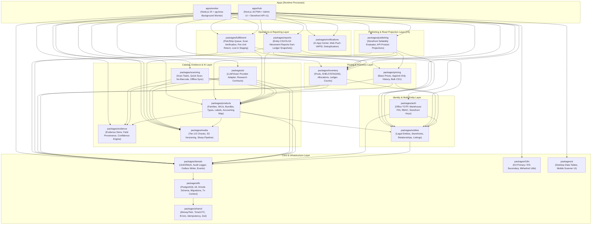

# AgroTrade Hub (Phase 1 — Online Warehouse) — Revised Architecture & Implementation Plan (v1.1 Corrections C1–C18)

ეს დოკუმენტი წარმოადგენს [AgroTrade Hub — Technical Specification v1.2](file:///d:/desk/web%20sites/agrotrade-warehouse/docs/AgroTrade%20Hub%20%E2%80%94%20Technical%20Specification%20v1.2.md)-ისა და [AgroTrade Hub — Corrections to Implementation Plan v1.1](file:///d:/desk/web%20sites/agrotrade-warehouse/docs/AgroTrade%20Hub%20%E2%80%94%20Corrections%20to%20Implementation%20Plan%20v1.1.md)-ის (`C1`–`C18`) სრულ, განახლებულ არქიტექტურულ და იმპლემენტაციის გეგმას პირველი ეტაპისთვის. ყველა შეცვლილი პუნქტი მონიშნულია შესაბამისი კორექტირების იდენტიფიკატორით (`[C1]`–`[C18]`).

---

## 0. Changelog (ცვლილებების ცხრილი — C1–C18)

| ID | რა შეიცვალა (What changed) | გეგმის სექცია (Plan section) |
| :--- | :--- | :--- |
| **C1** | `HANDED_OVER`-ის შემდეგ დაბრუნებები გავიდა Hub-ის ფარგლებს გარეთ. სქემიდან, მატრიციდან, რეპორტებიდან და ტესტებიდან სრულად ამოღებულია `RETURN_RESTOCK` და `MANUAL_RESTORE`. დაბრუნებული ნივთის ხელახალი მიღება ხდება მხოლოდ სტანდარტული `STOCK_IN`-ით. | §1.2, §2.4, §3, §5 (M8, M10), §6 |
| **C2** | დაემატა პულის დონის ბალანსის ცხრილი `pool_sku_balances` (`shelf`, `staging`, `allocated_total`, `unallocated`), 6 ინვარიანტი და მკაცრი ბლოკირების თანმიმდევრობა (`pool_sku_balances` → `allocation_balances`) Deadlock-ისა და ზედმეტი ალოკაციის გამოსარიცხად. | §2.4, §3.1, §3.2, §5 (M8), §6 (R1, R3, R10) |
| **C3** | ლეჯერის ინვარიანტების მატრიცა განახლდა ზუსტად 15 მოძრაობის ტიპზე (`pool_sku_balances` + `allocation_balances` დელტებით და წინაპირობებით), დაემატა **Rule A** (უარყოფითი shelf კორექტირება და staging-ის დანაკლისის გადაწყვეტა C14 პროცედურით) და **Rule B** (გადატანების წესები: იგივე მფლობელი, `CONSIGNMENT`, `PURCHASE`). | §2.4, §3.3, §3.4, §5 (M8), §6 (R5, R11) |
| **C4** | დაზუსტდა `CASH_ON_DELIVERY` და `PAY_ON_PICKUP` ნაკადები: აგროვება (`PICK_TO_STAGING`) დაშვებულია `RESERVED` სტატუსში; გადაცემისას ერთ ტრანზაქციაში იწერება `COMMIT` + `HANDOVER_OUT`; აგროვების შემდეგ გაუქმება მოითხოვს `RETURN_TO_SHELF` → `RESERVATION_RELEASE`; ტაიმაუტი არ აუქმებს `STAGING`-ში მყოფ სტრიქონს. დაემატა ღია გადაწყვეტილება #7. | §1.2, §2.4, §3.3, §4.1, §5 (M9), §6 (R4), §7 (#7) |
| **C5** | მოიხსნა პაკეტების ციკლური დამოკიდებულება: შეიქმნა `packages/publishing`, რომელიც ფლობს Sellability Evaluator-ს (§15.2) და Storefront პროდუქტის პროექციას. CI-ში დაემატა არქიტექტურული საზღვრების შემოწმება (`dependency-cruiser` / ESLint boundaries). | §1.1, §1.2, §5 (M1, M6, M9) |
| **C6** | Gateway + PWA spike გადმოტანილია **Milestone 1**-ში (რეალურ Android/iPhone-ზე შემოწმებით და ADR-ით); ავტომატური ბექაფები (PITR, ღამის სრული, S3 ვერსიირება) და პირველი Restore ტესტი გადმოტანილია **Milestone 3**-ის ბოლოს (პილოტურ მიღებამდე). | §5 (M1, M3, M11), §6 (R6, R7) |
| **C7** | მონაცემთა ბაზის დონეზე უცვლელობა (Append-only): `stock_ledger`, `audit_logs`, `storefront_prices`, `sku_slug_history` დაცულია ორმაგად — `UPDATE`/`DELETE` ამკრძალავი ტრიგერით და აპლიკაციის DB როლით (`hub_app`), რომელსაც არ აქვს `UPDATE`/`DELETE` უფლება ამ ცხრილებზე. | §2.6, §5 (M1, M2, M7, M8) |
| **C8** | `skus.canonical_slug` გახდა `NULL`-ებადი (ნაწილობრივი უნიკალური ინდექსით `WHERE canonical_slug IS NOT NULL`). სლაგი გენერირდება მხოლოდ `READY` სტატუსზე გადასვლისას დადასტურებული ბრენდიდან და მოდელიდან; შემდგომი ცვლილება იწერება `sku_slug_history`-ში. | §2.2, §5 (M2, M6) |
| **C9** | `accounting_mappings.owner_entity_id` გადაერქვა `legal_entity_id`-ად, ნაწილობრივი ინდექსით `(sku_id, legal_entity_id) WHERE active = TRUE`. | §2.2, §5 (M2) |
| **C10** | Outbox-ის მიწოდების სტატუსი გაიმიჯნა მომხმარებლების (consumers) მიხედვით: `outbox_events` გახდა უცვლელი, ხოლო თითოეული მიმღების სტატუსი იმართება ახალ `outbox_deliveries` ცხრილში. | §2.5, §5 (M1, M9) |
| **C11** | `legal_entities` ცხრილს დაემატა `prices_include_vat BOOLEAN NOT NULL`. `storefront_prices.vat_included`-ს მოეხსნა ჰარდკოდირებული `DEFAULT TRUE` და საწყის მნიშვნელობას იღებს მაღაზიის გამყიდველი იურიდიული პირიდან. | §2.1, §2.4, §5 (M1, M7) |
| **C12** | ერთი გლობალური `users.role` + `user_entity_memberships` შენარჩუნებულია Phase 1-ისთვის და ფორმალიზდება `ADR-001`-ში (შეზღუდვის აღწერითა და მომავალი მიგრაციის გზით). | §1.2, §2.1, §5 (M1) |
| **C13** | ფიზიკურად გამიჯნული პულები დათვლისთვის: ინვენტარიზაცია (`PHYSICAL_COUNT`) ტარდება თითო პულზე ცალ-ცალკე; Settings-ის ტექსტსა და ღია გადაწყვეტილება #3-ში დაემატა თითოეული პულის `SHELF` და `STAGING` ზონების ფიზიკური მარკირების მოთხოვნა. | §1.2, §5 (M8), §7 (#3) |
| **C14** | `STAGING`-ში დაკარგული/განადგურებული ერთეულისთვის დაემატა `ADJUSTMENT (staging, −)` სტრიქონი C3 მატრიცაში (ყალბი `RETURN_TO_SHELF`-ის გარეშე), მხოლოდ `ADMIN`-ისთვის, სავალდებულო მიზეზით, რომელიც ერთ ტრანზაქციაში აუქმებს მოთხოვნას მიზეზით `UNIT_LOST` და აგზავნის Webhook-ს. | §1.2, §2.4, §3.3, §3.4, §4.4, §5 (M8, M9), §6 (R11) |
| **C15** | კომპოზიტური ბანდლები: Storefront აგზავნის მხოლოდ ბანდლის SKU-ს; Hub შლის მას კომპონენტებად რეზერვაციის დროს და ინახავს snapshot-ს `reservation_lines.parent_bundle_sku_id`-ში. აგროვება, შესრულება და გადაცემა ეყრდნობა რეზერვაციის snapshot-ს და არა მიმდინარე ბანდლის განმარტებას. დაემატა ღია გადაწყვეტილება #8. | §1.2, §2.4, §4.3, §5 (M9), §7 (#8) |
| **C16** | ნაწილობრივ აგროვებული მოთხოვნის გაუქმება: თაროზე დაბრუნების წესი მოქმედებს თითოეულ ერთეულზე (`picked_quantity` vs `returned_quantity`) და არა მთლიანი მოთხოვნის სტატუსზე (`PICKING` თუ `PICKED`). უკვე `STAGING`-ში მყოფი ერთეულები მოითხოვს სკანირებით `RETURN_TO_SHELF`-ს, ხოლო ჯერ არა-აგროვებული ერთეულები თავისუფლდება დაუყოვნებლივ. | §1.2, §4.2, §5 (M9), §6 (R4) |
| **C17** | კომერციული რეჟიმის ცვლილება (`CONSIGNMENT` ↔ `PURCHASE`): Phase 1-ში არ ხდება ცოცხალი გადართვა აქტიური ნაშთებით. `CONSIGNMENT → PURCHASE` იბლოკება, სანამ ჯვარედინ ალოკაციებზე არსებობს ღია რეზერვაცია ან ვალდებულება. ისტორიული ლეჯერის სტრიქონები უცვლელია. | §1.2, §3.5, §5 (M8), §6 (R13) |
| **C18** | Sellability მოწმდება მხოლოდ `RESERVE`-ის დროს; უკვე `RESERVED` ან `COMMITTED` სტრიქონები სრულდება ჩვეულებრივ ლისტინგის/მეპინგის გათიშვის მიუხედავად. `COMMIT`-ის დროს `stock_ledger`-ში იწერება ბუღალტრული მეპინგის snapshot (`seller_accounting_item_id`, `seller_accounting_name`, `owner_accounting_item_id`, `owner_accounting_name`), რომელსაც ეყრდნობა რეპორტები. | §1.2, §2.4, §3.6, §5 (M8, M9, M10), §6 (R14) |

---

## 1. Module Boundaries (მოდულების საზღვრები და პასუხისმგებლობები)

სისტემა იყოფა ორ გაშვებად აპლიკაციად (`apps/*`) და მკაცრად იზოლირებულ დომენურ პაკეტებად (`packages/*`).

### 1.1 Monorepo-ს სტრუქტურა და დამოკიდებულებების გრაფი (DAG) `[C5]`

`[C5]` კატალოგისა და კომერციული შრეების ზემოთ ემატება `packages/publishing`, რათა სრულად გამოირიცხოს ციკლური დამოკიდებულება `products`, `pricing`, `entities` და `inventory` პაკეტებს შორის. CI-ში ემატება `dependency-cruiser` / ESLint boundaries შემოწმება, რომელიც ბლოკავს ნებისმიერ ციკლს ან აკრძალულ იმპორტს.



### 1.2 პაკეტების დეტალური საზღვრები (Ownership & Contracts)

| პაკეტი | ფლობს (Owns) | ეკრძალება (Forbidden) |
| :--- | :--- | :--- |
| `packages/shared` | `MoneyMinor` (თეთრი, `GEL`), UTC / `Asia/Tbilisi` ფორმატირება, `CorrelationId`, სტანდარტული შეცდომები, Zod-ის ბაზისური სქემები. | ბაზასთან ან გარე სერვისებთან წვდომა. |
| `packages/db` | Drizzle ORM სქემები, მიგრაციები (`hub_migrator` როლით), აპლიკაციის კავშირის პული (`hub_app` როლით `[C7]`), ტრანზაქციის კონტექსტი (`DbTransaction`). | ბიზნეს-ლოგიკის ან ვალიდაციის წესების ქონა. |
| `packages/domain` | `withDomainTransaction()` ჰელპერი (ატომურად წერს ბიზნეს-ცვლილებას + `stock_ledger` + `audit_logs` + `outbox_events` + `outbox_deliveries` `[C10]`), `IdempotencyGuard`. | კონკრეტული დომენის (მაგ. ფასების ან მარაგების) წესების ცოდნა. |
| `packages/auth` | სესიები, Office (Email + Password + სავალდებულო TOTP `ADMIN`/`STOCK_MANAGER`-ისთვის), საწყობის გაზიარებული ტელეფონის ავტორიზაცია (Device Token + პერსონალური PIN), RBAC (ერთი გლობალური `users.role` + `user_entity_memberships`, დოკუმენტირებული `ADR-001`-ში `[C12]`), Granular Permissions, Storefront API გასაღებების ჰეშირება და IP ფილტრაცია. | ბიზნეს-ობიექტების პირდაპირი მოდიფიკაცია. |
| `packages/entities` | `legal_entities` (`AGROTRADE`, `NEWBRAND`, მათ შორის `prices_include_vat` `[C11]`), `storefronts`, `entity_relationships` (`PURCHASE` \| `CONSIGNMENT` და რეჟიმის შეცვლის წინაპირობების ვალიდაცია `[C17]`), `storefront_listings` (§4.5). | ფასების ან მარაგების დათვლა. |
| `packages/products` | Product Family, SKU/Variant, Composed Bundle & Factory Kit (`is_kit`), 30 Product Type-ის სქემა, ერთეულების ნორმალიზაცია, `sku_identifiers` კოლიზიების დეტექციით, შიდა SKU (`AGT-000184`), QR/Code128 ეტიკეტების გენერაცია (58×40 მმ), `accounting_mappings` (`legal_entity_id`-ით `[C9]`), დეტერმინისტული Naming Engine (KA/EN), `canonical_slug` (ენიჭება მხოლოდ `READY`-ზე `[C8]`) + `sku_slug_history`, SKU Lifecycle State Machine (§15.1). | `pricing`, `inventory`, `fulfillment` ან `publishing` პაკეტების იმპორტი `[C5]`; მარაგების ნაშთების შეცვლა ან AI-ს სინქრონულად გამოძახება. |
| `packages/publishing` `[C5, C18]` | Per-Storefront Sellability Evaluator (§15.2: ამოწმებს `READY` სტატუსს, არა-ნულოვან `canonical_slug`-ს `[C8]`, გამყიდველისა და მფლობელის აქტიურ `accounting_mappings`-ს `[C9]`, აქტიურ საბაზისო ფასს, `VERIFIED` საჯარო მთავარ ფოტოს და ჩართულ `storefront_listings`-ს; მოწმდება მხოლოდ ახალი `RESERVE`-ის დროს `[C18]`) და Storefront API-ს პროდუქტის პროექციის აგება. | კატალოგის, ფასების ან მარაგების პირდაპირი მუტაცია. არცერთ ქვედა პაკეტს არ აქვს უფლება დააიმპორტოს `publishing` `[C5]`. |
| `packages/evidence` | `evidence` რეესტრი (`INVOICE` მხოლოდ `ADMIN`-ისთვის), `sku_field_provenance` (წყაროს პრიორიტეტები 1..9), Identity Confidence კალკულატორი (`HIGH`, `MEDIUM`, `LOW`, `CONFLICT`), კონფლიქტების გვერდიგვერდ შედარება. | კონფლიქტების ჩუმი (silent) გადაჭრა. |
| `packages/media` | 3 სლოტიანი ფოტო-ინსტრუქცია, Tier-1 (მოწყობილობაზე) და Tier-2 (სერვერზე) ხარისხის შემოწმება, S3 ვერსიირებული საცავი (`raw/`, `master/`, `web/`, `evidence/`), EXIF GPS-ის წაშლა, Sharp პაიპლაინი (1:1 კანვასი, 400/800/1600px WebP + AVIF), Storefront-ის `media_base_url`-ზე პუბლიკაცია. | Raw ორიგინალის გადაწერა ან პროდუქტის გეომეტრიის/ფერის/ლოგოს შეცვლა. |
| `packages/scanning` | დავალებები (`INTAKE_UNIQUE`, `PHYSICAL_COUNT`, `PHOTO_REQUEST`, `EVIDENCE_REQUEST`, `PICK`), Admin Quick Scan, უშტრიხკოდო მიღება (`Labels to print` რიგი), BarcodeDetector + ZXing fallback, IndexedDB ოფლაინ რიგის სინქრონიზაციის კონტრაქტი. | AI-ს ან ქსელის ლოდინი სკანირების დროს. |
| `packages/ai` | LLM/Vision აბსტრაქცია, პრომპტების ვერსიირება, ტოკენების/ხარჯის ლოგირება, Product Type-ის Research Contracts, 8 ფონური ჯობი (`pg-boss`). | მონაცემების გამოგონება (hallucination); უცნობი ველი ყოველთვის არის `value: null, status: NOT_FOUND`. |
| `packages/pricing` | `storefront_prices` (append-only ისტორია თეთრებში, VAT საწყისი მნიშვნელობა გამყიდველი იურიდიული პირიდან `[C11]`), >=30%-იანი ცვლილების დადასტურების წესი, Bulk ცხრილური რედაქტირება და CSV იმპორტ/ექსპორტი preview-თი, `PRICE_CHANGED` ივენთი. | ფასდაკლებების, კუპონების ან აქციების მართვა. |
| `packages/inventory` | `stock_pools`, `pool_locations` (`SHELF`, `STAGING`), `allocations`, უცვლელი `stock_ledger` (ზუსტად 15 მოძრაობის ტიპი, ბუღალტრული მეპინგის snapshot-ით `COMMIT`-ზე `[C1, C3, C18]`), მატერიალიზებული `pool_sku_balances` და `allocation_balances` (`SELECT ... FOR UPDATE` მკაცრი თანმიმდევრობით `[C2]`), ხელით შეტანა, გადატანები (Rule B `[C3]`), რეზერვაციის ძრავა გადახდის მეთოდების მიხედვით `[C4]`, კომპოზიტური ბანდლების გაშლა კომპონენტებად `reservation_lines`-ში `[C15]`, პულის მიხედვით იზოლირებული `PHYSICAL_COUNT` შედარება `[C13]` (Rule A `[C3]` და `ADJUSTMENT (staging, −)` `[C14]`), `replenishment_requests`. | `HANDED_OVER`-ის შემდეგ დაბრუნებების ასახვა `[C1]`; ბუღალტრულ სისტემასთან (FMG) პირდაპირი ინტეგრაცია; გადახდისას ფიზიკური მარაგის ჩამოწერა. |
| `packages/fulfillment` | `fulfillment_requests`, ბანდლების გაშლა `reservation_lines` snapshot-იდან `[C15]`, ერთიანი საწყობის რიგი, სკანირებით აგროვება (`PICK_TO_STAGING`, მათ შორის `RESERVED` სტატუსში COD/Pickup-ისთვის `[C4]`), გადაცემა (`HANDOVER_OUT`, ხოლო COD/Pickup-ზე ატომური `COMMIT` + `HANDOVER_OUT` `[C4]`), გაუქმებისას თითოეულ აგროვებულ ერთეულზე (`picked_quantity > returned_quantity`) `RETURN_TO_SHELF` სკანირების მოთხოვნა `[C16]`, და `ADMIN`-ის "Lost in staging" პროცედურა (`ADJUSTMENT (staging, −)` + `CANCELLED` მიზეზით `UNIT_LOST` `[C14]`). | კლიენტის პერსონალური მონაცემების მიღება/შენახვა (§1.3, §11.4); `HANDED_OVER`-ის შემდეგ ნებისმიერი ცვლილება `[C1]`. |
| `packages/reports` | მოძრაობის რეპორტები იურიდიული პირების მიხედვით (`CSV`, `XLSX`) ქართული სათაურებით, `COMMIT` (გაყიდვის თარიღი) და `HANDOVER_OUT` (ფიზიკური გასვლის თარიღი) გამიჯვნით, Seller და Owner ხედები. კითხულობს `COMMIT`-ის დროს `stock_ledger`-ში ჩაწერილ ბუღალტრულ snapshot-ს და არა მიმდინარე მეპინგს `[C18]`. არ შეიცავს დაბრუნებების (returns) ინფორმაციას `[C1]`. | საგადასახადო დოკუმენტების ან ინვოისების გენერაცია. |
| `packages/notifications` | In-App შეტყობინებები + Web Push (VAPID), ღრმა ბმულები (deep-links), სტატუსის გადასვლაზე დედუპლიკაცია, `INFO`-ს დადუმება (`ACTION_REQUIRED`/`CRITICAL` არ ითიშება). | Push payload-ში ფასების ან პერსონალური მონაცემების ჩადება. |

---

## 2. Proposed Database Schema (PostgreSQL 18 + Drizzle ORM)

ყველა ცხრილი იყენებს `UUIDv7`-ს, `timestamptz` (UTC), ხოლო ფული ინახება `BIGINT`-ად თეთრებში (`_minor`) ვალუტის კოდით (`GEL`).

### 2.1 Identity, Auth & Multi-Entity (`auth`, `entities`) `[C11, C12, C17]`

```sql
-- იურიდიული პირები (§4.1, [C11])
CREATE TABLE legal_entities (
  id UUID PRIMARY KEY,
  key TEXT NOT NULL UNIQUE,               -- 'AGROTRADE', 'NEWBRAND'
  legal_name TEXT NOT NULL,
  tax_id TEXT NOT NULL UNIQUE,
  prices_include_vat BOOLEAN NOT NULL,    -- [C11] VAT საწყისი პარამეტრი იურიდიული პირის მიხედვით
  active BOOLEAN NOT NULL DEFAULT TRUE,
  created_at TIMESTAMPTZ NOT NULL DEFAULT NOW()
);

-- კომერციული ურთიერთობის რეჟიმი იურიდიულ პირებს შორის (§4.4, [C17])
CREATE TABLE entity_relationships (
  id UUID PRIMARY KEY,
  from_entity_id UUID NOT NULL REFERENCES legal_entities(id),
  to_entity_id UUID NOT NULL REFERENCES legal_entities(id),
  mode TEXT NOT NULL CHECK (mode IN ('PURCHASE', 'CONSIGNMENT')),
  effective_from TIMESTAMPTZ NOT NULL,
  notes TEXT,
  created_by UUID,
  created_at TIMESTAMPTZ NOT NULL DEFAULT NOW()
);

-- სავაჭრო არხები / მაღაზიები (§4.2)
CREATE TABLE storefronts (
  id UUID PRIMARY KEY,
  key TEXT NOT NULL UNIQUE,
  name TEXT NOT NULL,
  domain TEXT NOT NULL UNIQUE,
  seller_entity_id UUID NOT NULL REFERENCES legal_entities(id),
  media_base_url TEXT NOT NULL,
  webhook_url TEXT,
  webhook_secret_encrypted TEXT,
  reservation_policy_json JSONB NOT NULL DEFAULT '{"CARD": 1800, "BANK_INSTALLMENT": 259200, "PAY_ON_PICKUP": 259200, "CASH_ON_DELIVERY": 259200}',
  active BOOLEAN NOT NULL DEFAULT TRUE,
  created_at TIMESTAMPTZ NOT NULL DEFAULT NOW()
);

-- Storefront-ის სერვის-გასაღებები (§12.1, §16.2)
CREATE TABLE storefront_api_keys (
  id UUID PRIMARY KEY,
  storefront_id UUID NOT NULL REFERENCES storefronts(id),
  name TEXT NOT NULL,
  key_prefix TEXT NOT NULL,
  key_hash TEXT NOT NULL UNIQUE,
  allowed_ips TEXT[],
  active BOOLEAN NOT NULL DEFAULT TRUE,
  expires_at TIMESTAMPTZ,
  last_used_at TIMESTAMPTZ,
  created_at TIMESTAMPTZ NOT NULL DEFAULT NOW(),
  revoked_at TIMESTAMPTZ
);

-- მომხმარებლები და როლები (§13.1, §13.2, [C12] — გლობალური role დოკუმენტირებულია ADR-001-ში)
CREATE TABLE users (
  id UUID PRIMARY KEY,
  email TEXT UNIQUE,
  full_name TEXT NOT NULL,
  password_hash TEXT,
  totp_secret_encrypted TEXT,
  totp_enabled BOOLEAN NOT NULL DEFAULT FALSE,
  pin_hash TEXT,
  role TEXT NOT NULL CHECK (role IN ('ADMIN', 'OPERATOR', 'STOCK_MANAGER', 'WAREHOUSE', 'ORDER_MANAGER')),
  locale TEXT NOT NULL DEFAULT 'ka' CHECK (locale IN ('ka', 'en')),
  active BOOLEAN NOT NULL DEFAULT TRUE,
  created_at TIMESTAMPTZ NOT NULL DEFAULT NOW(),
  updated_at TIMESTAMPTZ NOT NULL DEFAULT NOW()
);

CREATE TABLE user_entity_memberships (
  user_id UUID NOT NULL REFERENCES users(id) ON DELETE CASCADE,
  legal_entity_id UUID NOT NULL REFERENCES legal_entities(id) ON DELETE CASCADE,
  is_stock_manager_recipient BOOLEAN NOT NULL DEFAULT FALSE,
  is_report_recipient BOOLEAN NOT NULL DEFAULT FALSE,
  PRIMARY KEY (user_id, legal_entity_id)
);

CREATE TABLE user_permissions (
  user_id UUID NOT NULL REFERENCES users(id) ON DELETE CASCADE,
  permission_key TEXT NOT NULL,
  granted_by UUID NOT NULL REFERENCES users(id),
  created_at TIMESTAMPTZ NOT NULL DEFAULT NOW(),
  PRIMARY KEY (user_id, permission_key)
);

CREATE TABLE registered_devices (
  id UUID PRIMARY KEY,
  device_name TEXT NOT NULL,
  device_token_hash TEXT NOT NULL UNIQUE,
  registered_by UUID NOT NULL REFERENCES users(id),
  active BOOLEAN NOT NULL DEFAULT TRUE,
  revoked_at TIMESTAMPTZ,
  last_seen_at TIMESTAMPTZ,
  created_at TIMESTAMPTZ NOT NULL DEFAULT NOW()
);
```

### 2.2 Product Master, Taxonomy, Identifiers & Accounting Mappings (`products`) `[C8, C9]`

```sql
CREATE TABLE categories (
  id UUID PRIMARY KEY,
  key TEXT NOT NULL UNIQUE,
  parent_id UUID REFERENCES categories(id),
  name_ka TEXT NOT NULL,
  name_en TEXT NOT NULL,
  is_unclassified BOOLEAN NOT NULL DEFAULT FALSE,
  sort_order INTEGER NOT NULL DEFAULT 0
);

CREATE TABLE product_types (
  id UUID PRIMARY KEY,
  key TEXT NOT NULL UNIQUE,
  default_category_id UUID NOT NULL REFERENCES categories(id),
  name_ka TEXT NOT NULL,
  name_en TEXT NOT NULL,
  attribute_schema_json JSONB NOT NULL,
  photo_instructions_json JSONB NOT NULL,
  naming_template_ka TEXT NOT NULL,
  naming_template_en TEXT NOT NULL,
  ai_research_contract_json JSONB NOT NULL,
  active BOOLEAN NOT NULL DEFAULT TRUE,
  updated_at TIMESTAMPTZ NOT NULL DEFAULT NOW()
);

CREATE TABLE product_families (
  id UUID PRIMARY KEY,
  code TEXT NOT NULL UNIQUE,
  product_type_id UUID REFERENCES product_types(id),
  category_id UUID REFERENCES categories(id),
  brand TEXT,
  manufacturer TEXT,
  base_model TEXT,
  title_ka TEXT NOT NULL,
  title_en TEXT,
  created_at TIMESTAMPTZ NOT NULL DEFAULT NOW(),
  updated_at TIMESTAMPTZ NOT NULL DEFAULT NOW()
);

-- SKU / ვარიანტი (§5.1 - §5.12, §15.1, [C8])
CREATE TABLE skus (
  id UUID PRIMARY KEY,
  internal_sku TEXT NOT NULL UNIQUE,      -- მაგ. 'AGT-000184'
  product_family_id UUID REFERENCES product_families(id),
  product_type_id UUID REFERENCES product_types(id),
  category_id UUID NOT NULL REFERENCES categories(id),
  canonical_slug TEXT,                    -- [C8] NULL-ებადი მიღებისას; გენერირდება მხოლოდ READY-ზე გადასვლისას
  lifecycle_state TEXT NOT NULL CHECK (lifecycle_state IN (
    'INTAKE', 'IDENTIFYING', 'IDENTIFICATION_REQUIRED', 'IDENTIFIED',
    'ACCOUNTING_MAPPING_REQUIRED', 'CONTENT_GENERATING', 'CONTENT_REVIEW',
    'READY', 'ARCHIVED'
  )),
  identity_confidence TEXT NOT NULL DEFAULT 'LOW' CHECK (identity_confidence IN (
    'HIGH', 'MEDIUM', 'LOW', 'CONFLICT'
  )),
  is_composed_bundle BOOLEAN NOT NULL DEFAULT FALSE,
  is_kit BOOLEAN NOT NULL DEFAULT FALSE,
  kit_components_json JSONB,
  brand TEXT,
  manufacturer TEXT,
  model_code TEXT,
  key_differentiator_ka TEXT,
  key_differentiator_en TEXT,

  -- უნივერსალური ნორმალიზებული ერთეულები (§5.6)
  power_kw NUMERIC(10,3),
  engine_displacement_cm3 NUMERIC(10,2),
  length_mm NUMERIC(10,2),
  width_mm NUMERIC(10,2),
  height_mm NUMERIC(10,2),
  working_width_mm NUMERIC(10,2),
  working_depth_mm NUMERIC(10,2),
  weight_kg NUMERIC(10,3),
  volume_l NUMERIC(10,3),
  pressure_bar NUMERIC(10,2),
  flow_l_min NUMERIC(10,2),
  voltage_v NUMERIC(10,2),
  current_a NUMERIC(10,2),
  unit_source_strings_json JSONB NOT NULL DEFAULT '{}',

  type_attributes_json JSONB NOT NULL DEFAULT '{}',

  display_name_ka TEXT,
  display_name_en TEXT,
  short_description_ka TEXT,
  short_description_en TEXT,
  full_description_ka TEXT,
  full_description_en TEXT,
  search_aliases_ka TEXT[] NOT NULL DEFAULT '{}',
  search_aliases_en TEXT[] NOT NULL DEFAULT '{}',

  approved_by UUID REFERENCES users(id),
  approved_at TIMESTAMPTZ,
  created_at TIMESTAMPTZ NOT NULL DEFAULT NOW(),
  updated_at TIMESTAMPTZ NOT NULL DEFAULT NOW(),
  -- [C8] READY სტატუსზე სლაგი სავალდებულოა
  CHECK (lifecycle_state <> 'READY' OR canonical_slug IS NOT NULL)
);

-- [C8] ნაწილობრივი უნიკალური ინდექსი არა-ნულოვან სლაგებზე
CREATE UNIQUE INDEX idx_skus_canonical_slug ON skus (canonical_slug) WHERE canonical_slug IS NOT NULL;

-- სლაგების ისტორია — Append-Only (§5.11, [C7, C8])
CREATE TABLE sku_slug_history (
  id UUID PRIMARY KEY,
  sku_id UUID NOT NULL REFERENCES skus(id) ON DELETE RESTRICT,
  old_slug TEXT NOT NULL UNIQUE,
  changed_at TIMESTAMPTZ NOT NULL DEFAULT NOW()
);

CREATE TABLE bundle_components (
  bundle_sku_id UUID NOT NULL REFERENCES skus(id) ON DELETE CASCADE,
  component_sku_id UUID NOT NULL REFERENCES skus(id) ON DELETE RESTRICT,
  quantity INTEGER NOT NULL CHECK (quantity > 0),
  PRIMARY KEY (bundle_sku_id, component_sku_id),
  CHECK (bundle_sku_id <> component_sku_id)
);

CREATE TABLE sku_identifiers (
  id UUID PRIMARY KEY,
  sku_id UUID NOT NULL REFERENCES skus(id) ON DELETE CASCADE,
  identifier_type TEXT NOT NULL CHECK (identifier_type IN (
    'GTIN', 'UPC', 'MPN', 'FACTORY_MODEL', 'PLATE_VALUE',
    'SUPPLIER_CODE', 'ACCOUNTING_CODE', 'INTERNAL_SKU',
    'INTERNAL_QR', 'LEGACY_ALIAS'
  )),
  value TEXT NOT NULL,
  issuer_source TEXT,
  verified BOOLEAN NOT NULL DEFAULT FALSE,
  is_primary BOOLEAN NOT NULL DEFAULT FALSE,
  has_collision BOOLEAN NOT NULL DEFAULT FALSE,
  created_at TIMESTAMPTZ NOT NULL DEFAULT NOW()
);
CREATE INDEX idx_sku_identifiers_lookup ON sku_identifiers (identifier_type, value);

-- საბუღალტრო მეპინგი (§5.5, [C9])
CREATE TABLE accounting_mappings (
  id UUID PRIMARY KEY,
  sku_id UUID NOT NULL REFERENCES skus(id) ON DELETE CASCADE,
  legal_entity_id UUID NOT NULL REFERENCES legal_entities(id), -- [C9] გადაერქვა owner_entity_id-დან
  accounting_item_id TEXT NOT NULL,
  accounting_name TEXT NOT NULL,
  legacy_code TEXT,
  active BOOLEAN NOT NULL DEFAULT TRUE,
  notes TEXT,
  created_by UUID REFERENCES users(id),
  created_at TIMESTAMPTZ NOT NULL DEFAULT NOW(),
  updated_at TIMESTAMPTZ NOT NULL DEFAULT NOW()
);
-- [C9] ინდექსი აქტიურ მეპინგებზე
CREATE INDEX idx_accounting_mappings_sku_entity ON accounting_mappings (sku_id, legal_entity_id) WHERE active = TRUE;

CREATE TABLE storefront_listings (
  id UUID PRIMARY KEY,
  storefront_id UUID NOT NULL REFERENCES storefronts(id),
  sku_id UUID NOT NULL REFERENCES skus(id),
  enabled BOOLEAN NOT NULL DEFAULT FALSE,
  enabled_at TIMESTAMPTZ,
  enabled_by UUID REFERENCES users(id),
  disabled_at TIMESTAMPTZ,
  disabled_by UUID REFERENCES users(id),
  reason TEXT,
  UNIQUE (storefront_id, sku_id)
);
```

### 2.3 Evidence, Field Provenance, Scanning, Media & AI (`evidence`, `scanning`, `media`, `ai`)

```sql
CREATE TABLE scan_tasks (
  id UUID PRIMARY KEY,
  task_type TEXT NOT NULL CHECK (task_type IN (
    'INTAKE_UNIQUE', 'PHYSICAL_COUNT', 'PHOTO_REQUEST', 'EVIDENCE_REQUEST', 'PICK'
  )),
  title TEXT NOT NULL,
  assignee_user_id UUID REFERENCES users(id),
  assignee_role TEXT,
  product_type_id UUID REFERENCES product_types(id),
  target_sku_id UUID REFERENCES skus(id),
  pool_id UUID,                           -- [C13] PHYSICAL_COUNT ტარდება თითო პულზე ცალ-ცალკე
  fulfillment_request_id UUID,
  photos_required BOOLEAN NOT NULL DEFAULT TRUE,
  due_date TIMESTAMPTZ,
  status TEXT NOT NULL DEFAULT 'OPEN' CHECK (status IN ('OPEN', 'IN_PROGRESS', 'COMPLETED', 'CANCELLED')),
  target_count INTEGER,
  completed_count INTEGER NOT NULL DEFAULT 0,
  created_by UUID NOT NULL REFERENCES users(id),
  created_at TIMESTAMPTZ NOT NULL DEFAULT NOW(),
  completed_at TIMESTAMPTZ
);

CREATE TABLE product_intakes (
  id UUID PRIMARY KEY,
  task_id UUID REFERENCES scan_tasks(id),
  source_mode TEXT NOT NULL CHECK (source_mode IN ('TASK', 'QUICK_SCAN')),
  scanned_by UUID NOT NULL REFERENCES users(id),
  device_id UUID REFERENCES registered_devices(id),
  scanned_identifiers_json JSONB NOT NULL DEFAULT '[]',
  is_no_barcode BOOLEAN NOT NULL DEFAULT FALSE,
  matched_sku_id UUID REFERENCES skus(id),
  label_status TEXT NOT NULL DEFAULT 'NOT_REQUIRED' CHECK (label_status IN (
    'NOT_REQUIRED', 'TO_PRINT', 'PRINTED', 'ATTACHED'
  )),
  result_state TEXT NOT NULL DEFAULT 'PROCESSING' CHECK (result_state IN (
    'PROCESSING', 'MATCHED_EXISTING', 'NEW_DRAFT', 'MANUAL_IDENTIFICATION_REQUIRED'
  )),
  idempotency_key TEXT NOT NULL UNIQUE,
  scanned_at TIMESTAMPTZ NOT NULL,
  created_at TIMESTAMPTZ NOT NULL DEFAULT NOW()
);

CREATE TABLE evidence (
  id UUID PRIMARY KEY,
  sku_id UUID REFERENCES skus(id) ON DELETE SET NULL,
  product_family_id UUID REFERENCES product_families(id) ON DELETE SET NULL,
  intake_id UUID REFERENCES product_intakes(id) ON DELETE SET NULL,
  type TEXT NOT NULL CHECK (type IN (
    'PHOTO', 'SPEC_SHEET', 'IMPORTER_DOC', 'PACKING_LIST',
    'INVOICE', 'MANUAL', 'PACKAGING', 'DISTRIBUTOR', 'PUBLIC_URL'
  )),
  title TEXT NOT NULL,
  source TEXT,
  source_date DATE,
  uploaded_by UUID NOT NULL REFERENCES users(id),
  storage_key TEXT,
  url TEXT,
  verified BOOLEAN NOT NULL DEFAULT FALSE,
  admin_only BOOLEAN NOT NULL DEFAULT FALSE,
  notes TEXT,
  created_at TIMESTAMPTZ NOT NULL DEFAULT NOW()
);

CREATE TABLE sku_field_provenance (
  id UUID PRIMARY KEY,
  sku_id UUID NOT NULL REFERENCES skus(id) ON DELETE CASCADE,
  field_name TEXT NOT NULL,
  candidate_value_json JSONB,
  source_raw_text TEXT,
  status TEXT NOT NULL CHECK (status IN ('VERIFIED', 'UNVERIFIED', 'NOT_FOUND', 'CONFLICT')),
  source_type TEXT NOT NULL,
  priority_rank SMALLINT NOT NULL,
  evidence_id UUID REFERENCES evidence(id),
  verified_by UUID REFERENCES users(id),
  verified_at TIMESTAMPTZ,
  is_active_winner BOOLEAN NOT NULL DEFAULT FALSE,
  created_at TIMESTAMPTZ NOT NULL DEFAULT NOW()
);

CREATE TABLE product_images (
  id UUID PRIMARY KEY,
  sku_id UUID REFERENCES skus(id) ON DELETE CASCADE,
  intake_id UUID REFERENCES product_intakes(id) ON DELETE SET NULL,
  slot TEXT CHECK (slot IN ('MAIN', 'SECONDARY', 'IDENTIFICATION', 'EXTRA')),
  source_type TEXT NOT NULL CHECK (source_type IN ('WAREHOUSE', 'MANUFACTURER', 'LEGACY_SITE')),
  source_url TEXT,
  role TEXT NOT NULL CHECK (role IN ('MAIN', 'GALLERY', 'IDENTITY')),
  status TEXT NOT NULL DEFAULT 'UNVERIFIED' CHECK (status IN ('VERIFIED', 'UNVERIFIED', 'REJECTED', 'NEEDS_BETTER_SOURCE')),
  usage TEXT NOT NULL CHECK (usage IN ('PUBLIC', 'INTERNAL_EVIDENCE')),
  raw_storage_key TEXT,
  master_storage_key TEXT,
  master_version INTEGER NOT NULL DEFAULT 1,
  derivatives_json JSONB NOT NULL DEFAULT '{}',
  tier1_quality_json JSONB,
  tier2_quality_json JSONB,
  sort_order INTEGER NOT NULL DEFAULT 0,
  created_by UUID REFERENCES users(id),
  created_at TIMESTAMPTZ NOT NULL DEFAULT NOW()
);

CREATE TABLE ai_job_logs (
  id UUID PRIMARY KEY,
  job_name TEXT NOT NULL,
  target_type TEXT NOT NULL,
  target_id UUID NOT NULL,
  provider TEXT NOT NULL,
  model TEXT NOT NULL,
  prompt_version TEXT NOT NULL,
  input_tokens INTEGER,
  output_tokens INTEGER,
  cost_usd_micros BIGINT,
  status TEXT NOT NULL CHECK (status IN ('RUNNING', 'SUCCEEDED', 'FAILED', 'DEAD_LETTER')),
  error_text TEXT,
  created_at TIMESTAMPTZ NOT NULL DEFAULT NOW(),
  completed_at TIMESTAMPTZ
);
```

### 2.4 Pricing, Inventory Ledger, Reservations & Fulfillment (`pricing`, `inventory`, `fulfillment`) `[C1, C2, C3, C4, C7, C11, C13, C14, C15, C16, C18]`

```sql
-- საბაზისო ფასები მაღაზიების მიხედვით — Append-Only ისტორია (§9.1, [C7, C11])
CREATE TABLE storefront_prices (
  id UUID PRIMARY KEY,
  storefront_id UUID NOT NULL REFERENCES storefronts(id),
  sku_id UUID NOT NULL REFERENCES skus(id),
  base_price_minor BIGINT NOT NULL CHECK (base_price_minor > 0),
  currency TEXT NOT NULL DEFAULT 'GEL' CHECK (currency = 'GEL'),
  vat_included BOOLEAN NOT NULL,          -- [C11] DEFAULT TRUE მოხსნილია; ივსება seller_entity.prices_include_vat-იდან
  valid_from TIMESTAMPTZ NOT NULL DEFAULT NOW(),
  set_by UUID NOT NULL REFERENCES users(id),
  reason TEXT,
  created_at TIMESTAMPTZ NOT NULL DEFAULT NOW()
);
CREATE INDEX idx_storefront_prices_current ON storefront_prices (storefront_id, sku_id, valid_from DESC);

-- მარაგების პულები და ლოკაციები (§10.2, [C13])
CREATE TABLE stock_pools (
  id UUID PRIMARY KEY,
  owner_entity_id UUID NOT NULL REFERENCES legal_entities(id),
  name TEXT NOT NULL,
  location_note TEXT,                     -- [C13] ფიზიკურად მარკირებული თაროს/ზონის აღწერა
  active BOOLEAN NOT NULL DEFAULT TRUE,
  created_at TIMESTAMPTZ NOT NULL DEFAULT NOW()
);

CREATE TABLE pool_locations (
  id UUID PRIMARY KEY,
  pool_id UUID NOT NULL REFERENCES stock_pools(id) ON DELETE CASCADE,
  kind TEXT NOT NULL CHECK (kind IN ('SHELF', 'STAGING')),
  name TEXT NOT NULL,
  UNIQUE (pool_id, kind)
);

-- ალოკაციები მაღაზიებზე (§10.2, §10.8)
CREATE TABLE allocations (
  id UUID PRIMARY KEY,
  pool_id UUID NOT NULL REFERENCES stock_pools(id),
  storefront_id UUID NOT NULL REFERENCES storefronts(id),
  sku_id UUID NOT NULL REFERENCES skus(id),
  minimum_stock INTEGER NOT NULL DEFAULT 0 CHECK (minimum_stock >= 0),
  alert_state TEXT NOT NULL DEFAULT 'NORMAL' CHECK (alert_state IN ('NORMAL', 'LOW_STOCK', 'OUT_OF_STOCK')),
  created_at TIMESTAMPTZ NOT NULL DEFAULT NOW(),
  UNIQUE (pool_id, storefront_id, sku_id)
);

-- [C2] პულისა და SKU-ს დონის ჩაკეტვადი ბალანსის აგრეგატი (ანაცვლებს pool_location_balances-ს)
CREATE TABLE pool_sku_balances (
  pool_id          UUID NOT NULL REFERENCES stock_pools(id),
  sku_id           UUID NOT NULL REFERENCES skus(id),
  shelf            INTEGER NOT NULL DEFAULT 0 CHECK (shelf >= 0),
  staging          INTEGER NOT NULL DEFAULT 0 CHECK (staging >= 0),
  allocated_total  INTEGER NOT NULL DEFAULT 0 CHECK (allocated_total >= 0),
  unallocated      INTEGER GENERATED ALWAYS AS (shelf + staging - allocated_total) STORED,
  updated_at       TIMESTAMPTZ NOT NULL DEFAULT NOW(),
  PRIMARY KEY (pool_id, sku_id),
  CHECK (allocated_total <= shelf + staging),
  CHECK (staging <= allocated_total)
);

-- მატერიალიზებული ალოკაციის ბალანსი (§10.2, [C2])
CREATE TABLE allocation_balances (
  allocation_id UUID PRIMARY KEY REFERENCES allocations(id),
  allocated INTEGER NOT NULL DEFAULT 0 CHECK (allocated >= 0),
  reserved INTEGER NOT NULL DEFAULT 0 CHECK (reserved >= 0),
  committed INTEGER NOT NULL DEFAULT 0 CHECK (committed >= 0),
  available_to_sell INTEGER GENERATED ALWAYS AS (allocated - reserved - committed) STORED,
  updated_at TIMESTAMPTZ NOT NULL DEFAULT NOW(),
  CHECK (allocated - reserved - committed >= 0)
);

-- უცვლელი (Immutable) მარაგების ლეჯერი — ზუსტად 15 მოძრაობის ტიპი (§10.6, [C1, C2, C3, C7, C14, C18])
CREATE TABLE stock_ledger (
  id UUID PRIMARY KEY,
  movement_type TEXT NOT NULL CHECK (movement_type IN (
    -- Physical (7)
    'STOCK_IN', 'STOCK_OUT', 'WRITE_OFF', 'ADJUSTMENT',
    'PICK_TO_STAGING', 'RETURN_TO_SHELF', 'HANDOVER_OUT',
    -- Allocation (4)
    'ALLOCATE', 'DEALLOCATE', 'TRANSFER_OUT', 'TRANSFER_IN',
    -- Commitment (4)
    'RESERVE', 'RESERVATION_RELEASE', 'COMMIT', 'COMMIT_RELEASE'
    -- [C1] RETURN_RESTOCK და MANUAL_RESTORE ამოღებულია
  )),
  sku_id UUID NOT NULL REFERENCES skus(id),
  pool_id UUID NOT NULL REFERENCES stock_pools(id),
  pool_location_id UUID REFERENCES pool_locations(id),
  allocation_id UUID REFERENCES allocations(id),
  quantity INTEGER NOT NULL CHECK (quantity > 0),

  -- [C2, C3, C14] 6 დელტა-სვეტი C3/C14 მატრიცის მიხედვით (3 pool-level + 3 allocation-level)
  shelf_delta INTEGER NOT NULL DEFAULT 0,
  staging_delta INTEGER NOT NULL DEFAULT 0,
  alloc_total_delta INTEGER NOT NULL DEFAULT 0,
  allocated_delta INTEGER NOT NULL DEFAULT 0,
  reserved_delta INTEGER NOT NULL DEFAULT 0,
  committed_delta INTEGER NOT NULL DEFAULT 0,

  owner_entity_id UUID NOT NULL REFERENCES legal_entities(id),
  seller_entity_id UUID REFERENCES legal_entities(id),
  storefront_id UUID REFERENCES storefronts(id),
  relationship_mode TEXT CHECK (relationship_mode IN ('SAME_ENTITY', 'PURCHASE', 'CONSIGNMENT')),
  cross_entity BOOLEAN NOT NULL DEFAULT FALSE,
  external_document_ref TEXT,
  reported_unit_price_minor BIGINT,
  storefront_order_ref TEXT,

  -- [C18] ბუღალტრული მეპინგის Snapshot COMMIT-ის მომენტში (რეპორტები კითხულობს ამ ველებს)
  seller_accounting_item_id TEXT,
  seller_accounting_name TEXT,
  owner_accounting_item_id TEXT,
  owner_accounting_name TEXT,

  reservation_id UUID,
  fulfillment_request_id UUID,
  reconciliation_count_id UUID,
  actor_user_id UUID REFERENCES users(id),
  actor_storefront_id UUID REFERENCES storefronts(id),
  reason TEXT,
  correlation_id TEXT NOT NULL,
  created_at TIMESTAMPTZ NOT NULL DEFAULT NOW(),
  -- [C18] COMMIT სტრიქონზე გამყიდველისა და მფლობელის ბუღალტრული snapshot სავალდებულოა
  CHECK (
    movement_type <> 'COMMIT' OR (
      seller_accounting_item_id IS NOT NULL AND
      seller_accounting_name IS NOT NULL AND
      owner_accounting_item_id IS NOT NULL AND
      owner_accounting_name IS NOT NULL
    )
  )
);

-- რეზერვაციები (§10.7, [C4, C15])
CREATE TABLE reservations (
  id UUID PRIMARY KEY,
  storefront_id UUID NOT NULL REFERENCES storefronts(id),
  storefront_order_ref TEXT,
  payment_method TEXT NOT NULL CHECK (payment_method IN (
    'CARD', 'BANK_INSTALLMENT', 'PAY_ON_PICKUP', 'CASH_ON_DELIVERY'
  )),
  status TEXT NOT NULL CHECK (status IN (
    'RESERVED', 'COMMITTED', 'RELEASED', 'EXPIRED', 'HANDED_OVER'
  )),
  expires_at TIMESTAMPTZ,
  committed_at TIMESTAMPTZ,
  handed_over_at TIMESTAMPTZ,
  released_at TIMESTAMPTZ,
  release_reason TEXT,
  idempotency_key TEXT NOT NULL,
  created_at TIMESTAMPTZ NOT NULL DEFAULT NOW(),
  updated_at TIMESTAMPTZ NOT NULL DEFAULT NOW(),
  UNIQUE (storefront_id, idempotency_key)
);

-- [C15] ბანდლის გაშლის snapshot ინახება reservation_lines-ში (parent_bundle_sku_id)
CREATE TABLE reservation_lines (
  id UUID PRIMARY KEY,
  reservation_id UUID NOT NULL REFERENCES reservations(id) ON DELETE CASCADE,
  allocation_id UUID NOT NULL REFERENCES allocations(id),
  sku_id UUID NOT NULL REFERENCES skus(id),          -- კომპონენტის SKU (ან ჩვეულებრივი SKU)
  parent_bundle_sku_id UUID REFERENCES skus(id),     -- [C15] თუ სტრიქონი გაიშალა ბანდლიდან რეზერვაციისას
  bundle_reported_unit_price_minor BIGINT,           -- [C15] Storefront-ის მიერ გადმოცემული ბანდლის ფასი
  quantity INTEGER NOT NULL CHECK (quantity > 0),
  final_unit_price_minor BIGINT
);

CREATE TABLE replenishment_requests (
  id UUID PRIMARY KEY,
  allocation_id UUID NOT NULL REFERENCES allocations(id),
  owner_entity_id UUID NOT NULL REFERENCES legal_entities(id),
  storefront_id UUID NOT NULL REFERENCES storefronts(id),
  sku_id UUID NOT NULL REFERENCES skus(id),
  available_at_creation INTEGER NOT NULL,
  minimum_stock INTEGER NOT NULL,
  suggested_quantity INTEGER NOT NULL,
  status TEXT NOT NULL DEFAULT 'OPEN' CHECK (status IN ('OPEN', 'ACKNOWLEDGED', 'FULFILLED', 'DECLINED')),
  handled_by UUID REFERENCES users(id),
  notes TEXT,
  created_at TIMESTAMPTZ NOT NULL DEFAULT NOW(),
  updated_at TIMESTAMPTZ NOT NULL DEFAULT NOW()
);

-- ინვენტარიზაცია / შედარებითი დათვლა თითო პულზე ცალ-ცალკე (§10.11, [C3, C13])
CREATE TABLE reconciliation_counts (
  id UUID PRIMARY KEY,
  pool_id UUID NOT NULL REFERENCES stock_pools(id),
  scan_task_id UUID NOT NULL REFERENCES scan_tasks(id),
  status TEXT NOT NULL DEFAULT 'OPEN' CHECK (status IN ('OPEN', 'REVIEW_REQUIRED', 'CRITICAL_BLOCKED', 'APPROVED')),
  approved_by UUID REFERENCES users(id),
  approved_at TIMESTAMPTZ,
  created_at TIMESTAMPTZ NOT NULL DEFAULT NOW()
);

CREATE TABLE reconciliation_count_lines (
  id UUID PRIMARY KEY,
  reconciliation_count_id UUID NOT NULL REFERENCES reconciliation_counts(id) ON DELETE CASCADE,
  pool_location_id UUID NOT NULL REFERENCES pool_locations(id), -- SHELF და STAGING ცალ-ცალკე
  sku_id UUID NOT NULL REFERENCES skus(id),
  expected_qty INTEGER NOT NULL,
  counted_qty INTEGER NOT NULL,
  difference_qty INTEGER GENERATED ALWAYS AS (counted_qty - expected_qty) STORED,
  reason TEXT,
  UNIQUE (reconciliation_count_id, pool_location_id, sku_id)
);

-- შესრულების მოთხოვნები (Fulfillment Requests, §11, [C4, C14, C15, C16])
CREATE TABLE fulfillment_requests (
  id UUID PRIMARY KEY,
  storefront_id UUID NOT NULL REFERENCES storefronts(id),
  storefront_order_ref TEXT NOT NULL,
  delivery_method TEXT NOT NULL CHECK (delivery_method IN ('PICKUP', 'COURIER', 'OTHER')),
  ship_by DATE NOT NULL,
  internal_note TEXT,
  status TEXT NOT NULL DEFAULT 'REQUESTED' CHECK (status IN (
    'REQUESTED', 'PICKING', 'PICKED', 'ACTION_REQUIRED', 'HANDED_OVER', 'CANCELLED'
  )),
  cancel_reason TEXT,                     -- [C14] მაგ. 'UNIT_LOST', 'STOREFRONT_CANCELLED', 'ADMIN_CANCELLED'
  requires_return_to_shelf BOOLEAN NOT NULL DEFAULT FALSE,
  return_to_shelf_confirmed_at TIMESTAMPTZ,
  picked_at TIMESTAMPTZ,
  handed_over_at TIMESTAMPTZ,
  cancelled_at TIMESTAMPTZ,
  idempotency_key TEXT NOT NULL,
  created_at TIMESTAMPTZ NOT NULL DEFAULT NOW(),
  updated_at TIMESTAMPTZ NOT NULL DEFAULT NOW(),
  UNIQUE (storefront_id, idempotency_key)
);

-- [C15, C16] სტრიქონები იქმნება reservation_lines snapshot-იდან; ითვლის picked_quantity და returned_quantity-ს თითოეულ ერთეულზე
CREATE TABLE fulfillment_request_lines (
  id UUID PRIMARY KEY,
  fulfillment_request_id UUID NOT NULL REFERENCES fulfillment_requests(id) ON DELETE CASCADE,
  reservation_id UUID NOT NULL REFERENCES reservations(id),
  reservation_line_id UUID NOT NULL REFERENCES reservation_lines(id),
  sku_id UUID NOT NULL REFERENCES skus(id),          -- კომპონენტის SKU (reservation_lines snapshot-იდან [C15])
  parent_bundle_sku_id UUID REFERENCES skus(id),     -- [C15] თუ ბანდლის კომპონენტია
  quantity INTEGER NOT NULL CHECK (quantity > 0),
  picked_quantity INTEGER NOT NULL DEFAULT 0 CHECK (picked_quantity >= 0 AND picked_quantity <= quantity),
  returned_quantity INTEGER NOT NULL DEFAULT 0 CHECK (returned_quantity >= 0 AND returned_quantity <= picked_quantity),
  lost_in_staging_quantity INTEGER NOT NULL DEFAULT 0 CHECK (lost_in_staging_quantity >= 0 AND lost_in_staging_quantity <= picked_quantity - returned_quantity),
  final_unit_price_minor BIGINT NOT NULL CHECK (final_unit_price_minor >= 0)
);
```

### 2.5 Outbox, Webhooks, Notifications, Audit & Legacy SEO (`domain`, `notifications`) `[C7, C10]`

```sql
-- [C10] უცვლელი ტრანზაქციული Outbox ივენთები (§12.2)
CREATE TABLE outbox_events (
  id UUID PRIMARY KEY,
  event_type TEXT NOT NULL,
  storefront_id UUID REFERENCES storefronts(id),
  aggregate_type TEXT NOT NULL,
  aggregate_id UUID NOT NULL,
  payload_json JSONB NOT NULL,
  correlation_id TEXT NOT NULL,
  created_at TIMESTAMPTZ NOT NULL DEFAULT NOW()
);

-- [C10] Per-consumer მიწოდების სტატუსი (Storefront A, Storefront B, Notifications და ა.შ.)
CREATE TABLE outbox_deliveries (
  id               UUID PRIMARY KEY,
  outbox_event_id  UUID NOT NULL REFERENCES outbox_events(id),
  consumer         TEXT NOT NULL,   -- 'storefront:<id>' | 'notifications' | ...
  status           TEXT NOT NULL CHECK (status IN ('PENDING', 'DELIVERED', 'DEAD_LETTER')),
  attempts         INTEGER NOT NULL DEFAULT 0,
  next_attempt_at  TIMESTAMPTZ NOT NULL DEFAULT NOW(),
  delivered_at     TIMESTAMPTZ,
  UNIQUE (outbox_event_id, consumer)
);

-- თითოეული HTTP მცდელობის ჟურნალი (§12.2, [C10])
CREATE TABLE webhook_deliveries (
  id UUID PRIMARY KEY,
  outbox_event_id UUID NOT NULL REFERENCES outbox_events(id) ON DELETE CASCADE,
  outbox_delivery_id UUID REFERENCES outbox_deliveries(id) ON DELETE CASCADE,
  storefront_id UUID NOT NULL REFERENCES storefronts(id),
  response_status INTEGER,
  response_body_excerpt TEXT,
  duration_ms INTEGER,
  succeeded BOOLEAN NOT NULL,
  created_at TIMESTAMPTZ NOT NULL DEFAULT NOW()
);

CREATE TABLE notifications (
  id UUID PRIMARY KEY,
  user_id UUID NOT NULL REFERENCES users(id) ON DELETE CASCADE,
  event_type TEXT NOT NULL,
  level TEXT NOT NULL CHECK (level IN ('INFO', 'ACTION_REQUIRED', 'CRITICAL')),
  title_ka TEXT NOT NULL,
  body_ka TEXT NOT NULL,
  deep_link TEXT NOT NULL,
  action_label_ka TEXT NOT NULL,
  state_dedup_key TEXT,
  read_at TIMESTAMPTZ,
  created_at TIMESTAMPTZ NOT NULL DEFAULT NOW()
);

-- Append-Only აუდიტის ჟურნალი (§16.1, [C7])
CREATE TABLE audit_logs (
  id UUID PRIMARY KEY,
  actor_user_id UUID REFERENCES users(id),
  actor_storefront_id UUID REFERENCES storefronts(id),
  action TEXT NOT NULL,
  entity_type TEXT NOT NULL,
  entity_id TEXT NOT NULL,
  before_json JSONB,
  after_json JSONB,
  reason TEXT,
  external_document_ref TEXT,
  correlation_id TEXT NOT NULL,
  created_at TIMESTAMPTZ NOT NULL DEFAULT NOW()
);

CREATE TABLE idempotency_keys (
  scope TEXT NOT NULL,
  idempotency_key TEXT NOT NULL,
  request_hash TEXT NOT NULL,
  response_status INTEGER NOT NULL,
  response_body_json JSONB NOT NULL,
  created_at TIMESTAMPTZ NOT NULL DEFAULT NOW(),
  expires_at TIMESTAMPTZ NOT NULL,
  PRIMARY KEY (scope, idempotency_key)
);

CREATE TABLE legacy_urls (
  id UUID PRIMARY KEY,
  old_host TEXT NOT NULL,
  old_path_raw TEXT NOT NULL,
  old_path_normalized TEXT NOT NULL,
  entity_type TEXT NOT NULL CHECK (entity_type IN ('PRODUCT', 'CATEGORY', 'OTHER')),
  entity_id UUID,
  decision TEXT NOT NULL DEFAULT 'UNDECIDED' CHECK (decision IN ('KEEP_301', 'ARCHIVE_PAGE', 'GONE_410', 'UNDECIDED')),
  gsc_clicks_16m INTEGER,
  gsc_impressions_16m INTEGER,
  backlinks INTEGER,
  notes TEXT,
  created_at TIMESTAMPTZ NOT NULL DEFAULT NOW()
);
```

### 2.6 Append-Only Enforcement in PostgreSQL `[C7]`

`stock_ledger`, `audit_logs`, `storefront_prices` და `sku_slug_history` ცხრილების უცვლელობა (Append-only) დაცულია ორმაგად:

```sql
-- 1. ტრიგერი, რომელიც ბლოკავს UPDATE და DELETE ოპერაციებს [C7]
CREATE OR REPLACE FUNCTION prevent_append_only_mutation()
RETURNS TRIGGER LANGUAGE plpgsql AS $$
BEGIN
  RAISE EXCEPTION 'Table % is append-only; % is forbidden.', TG_TABLE_NAME, TG_OP;
END;
$$;

CREATE TRIGGER trg_stock_ledger_immutable
  BEFORE UPDATE OR DELETE ON stock_ledger
  FOR EACH ROW EXECUTE FUNCTION prevent_append_only_mutation();

CREATE TRIGGER trg_audit_logs_immutable
  BEFORE UPDATE OR DELETE ON audit_logs
  FOR EACH ROW EXECUTE FUNCTION prevent_append_only_mutation();

CREATE TRIGGER trg_storefront_prices_immutable
  BEFORE UPDATE OR DELETE ON storefront_prices
  FOR EACH ROW EXECUTE FUNCTION prevent_append_only_mutation();

CREATE TRIGGER trg_sku_slug_history_immutable
  BEFORE UPDATE OR DELETE ON sku_slug_history
  FOR EACH ROW EXECUTE FUNCTION prevent_append_only_mutation();

-- 2. მონაცემთა ბაზის როლების გამიჯვნა [C7]
-- მიგრაციები ეშვება hub_migrator როლით; აპლიკაცია და ვორკერი მუშაობენ hub_app როლით:
REVOKE UPDATE, DELETE, TRUNCATE ON stock_ledger, audit_logs, storefront_prices, sku_slug_history FROM hub_app;
GRANT SELECT, INSERT ON stock_ledger, audit_logs, storefront_prices, sku_slug_history TO hub_app;
```

---

## 3. Ledger Invariants, Locking Order & 15-Type Matrix `[C1, C2, C3, C4, C14, C17, C18]`

### 3.1 Pool & Allocation Invariants `[C2]`

ყველა სასაწყობო ოპერაცია ვალდებულია დაიცვას შემდეგი 6 ინვარიანტი (კონტროლდება PostgreSQL `CHECK` შეზღუდვებითა და დომენური ტესტებით; ნებისმიერი მოძრაობა, რომელიც არღვევს ინვარიანტს, უარყოფილია და არასდროს იჭრება/clamped `[C3]`):

1. `shelf >= 0`, `staging >= 0`.
2. `allocated_total = Σ allocation_balances.allocated` მოცემული პულისა და SKU-სთვის.
3. `allocated_total <= shelf + staging` — ალოკირებული რაოდენობა არასდროს აღემატება ფიზიკურად არსებულს.
4. `staging <= allocated_total` — `STAGING`-ში მყოფი ერთეულები ყოველთვის არის შესრულების პროცესში მყოფი ალოკირებული ერთეულები.
5. თითოეული ალოკაციისთვის: `reserved >= 0`, `committed >= 0`, `allocated - reserved - committed >= 0`.
6. `stock_ledger`-იდან თავიდან დათვლილი ბალანსები ყოველთვის უდრის `pool_sku_balances`-სა და `allocation_balances`-ში შენახულ მნიშვნელობებს.

### 3.2 Deadlock-Free Locking Order `[C2]`

ყოველი სასაწყობო ტრანზაქცია იღებს `SELECT ... FOR UPDATE` ბლოკირებას მკაცრად განსაზღვრული თანმიმდევრობით:

1. **`pool_sku_balances`** სტრიქონები, დალაგებული `(pool_id, sku_id)` ზრდადობით.
2. **`allocation_balances`** სტრიქონები, დალაგებული `allocation_id` ზრდადობით.

- ყველა **ფიზიკური** (`STOCK_IN`, `STOCK_OUT`, `WRITE_OFF`, `ADJUSTMENT`, `PICK_TO_STAGING`, `RETURN_TO_SHELF`, `HANDOVER_OUT`) და **ალოკაციის** (`ALLOCATE`, `DEALLOCATE`, `TRANSFER_OUT`, `TRANSFER_IN`) მოძრაობა სავალდებულოდ კეტავს `pool_sku_balances` სტრიქონს, მაშინაც კი, როცა იცვლება მხოლოდ ერთი ალოკაცია.
- მხოლოდ რეზერვაციის/ვალდებულების მოძრაობები (`RESERVE`, `RESERVATION_RELEASE`, `COMMIT`, `COMMIT_RELEASE`) კეტავს მხოლოდ `allocation_balances` სტრიქონებს.

### 3.3 Complete Invariant Matrix (15 Movement Types) `[C1, C3, C4, C14]`

ლეჯერს აქვს ზუსტად **15 მოძრაობის ტიპი** (`RETURN_RESTOCK` და `MANUAL_RESTORE` ამოღებულია `[C1]`, ხოლო `ADJUSTMENT`-ს აქვს 3 ვარიანტი: `shelf +`, `shelf −` და `staging −` `[C3, C14]`).
სვეტები `shelf`, `staging` და `alloc_total` ეკუთვნის პულის დონეს (`pool_sku_balances`); `allocated`, `reserved` და `committed` ეკუთვნის კონკრეტულ ალოკაციას (`allocation_balances`). `n > 0`.
`available_to_sell = allocated - reserved - committed`; `unallocated = shelf + staging - alloc_total`.

| Type | `shelf` | `staging` | `alloc_total` | `allocated` | `reserved` | `committed` | Precondition (მოწმდება Lock-ის ქვეშ) |
| :--- | :---: | :---: | :---: | :---: | :---: | :---: | :--- |
| `STOCK_IN` | `+n` | `0` | `0` | `0` | `0` | `0` | — |
| `STOCK_OUT` | `-n` | `0` | `0` | `0` | `0` | `0` | `n <= unallocated` |
| `WRITE_OFF` | `-n` | `0` | `0` | `0` | `0` | `0` | `n <= unallocated`; reason required |
| `ADJUSTMENT` (shelf, +) | `+n` | `0` | `0` | `0` | `0` | `0` | Approved count line; reason |
| `ADJUSTMENT` (shelf, −) | `-n` | `0` | `0` | `0` | `0` | `0` | `n <= unallocated` (იხ. **Rule A**) |
| `ADJUSTMENT` (staging, −) `[C14]` | `0` | `-n` | `-n` | `-n` | `0` / `-n` (COD) | `-n` / `0` (COD) | `ADMIN` only; reason; `n <= staged units` of the line (`[C14]`) |
| `ALLOCATE` | `0` | `0` | `+n` | `+n` | `0` | `0` | `n <= unallocated` |
| `DEALLOCATE` | `0` | `0` | `-n` | `-n` | `0` | `0` | `n <= available_to_sell` |
| `TRANSFER_OUT` (same pool) | `0` | `0` | `-n` | `-n` | `0` | `0` | `n <= available_to_sell` of source allocation |
| `TRANSFER_IN` (same pool) | `0` | `0` | `+n` | `+n` | `0` | `0` | Paired with `TRANSFER_OUT`, same `correlation_id` |
| `TRANSFER_OUT` (to other pool) | `-n` | `0` | `0` | `0` | `0` | `0` | `n <= unallocated` of source pool; document ref (იხ. **Rule B**) |
| `TRANSFER_IN` (from other pool) | `+n` | `0` | `0` | `0` | `0` | `0` | Paired; target pool owned by receiving entity |
| `RESERVE` | `0` | `0` | `0` | `0` | `+n` | `0` | `n <= available_to_sell`; SKU sellable on storefront `[C18]` |
| `RESERVATION_RELEASE` | `0` | `0` | `0` | `0` | `-n` | `0` | `n <= reserved`; line not in staging (or `RETURN_TO_SHELF` first) |
| `COMMIT` | `0` | `0` | `0` | `0` | `-n` | `+n` | `n <= reserved`; writes accounting snapshot `[C18]` |
| `COMMIT_RELEASE` | `0` | `0` | `0` | `0` | `0` | `-n` | `n <= committed`; line not in staging (or `RETURN_TO_SHELF` first) |
| `PICK_TO_STAGING` | `-n` | `+n` | `0` | `0` | `0` | `0` | Line is `COMMITTED`, or `RESERVED` under COD/pickup `[C4]` |
| `RETURN_TO_SHELF` | `+n` | `-n` | `0` | `0` | `0` | `0` | `n <= staged units` of the fulfillment request; scan-confirmed |
| `HANDOVER_OUT` | `0` | `-n` | `-n` | `-n` | `0` | `-n` | `n <= committed` and `n <= staged units` of the request |

### 3.4 Domain Rules A & B (Adjustments & Transfers) `[C3, C14]`

- **Rule A — უარყოფითი shelf კორექტირება `unallocated`-ზე მეტი დანაკლისისას `[C3, C14]`:**
  - თუ ინვენტარიზაციამ (`PHYSICAL_COUNT`) აღმოაჩინა მოსალოდნელზე ნაკლები ერთეული და დანაკლისი აღემატება `unallocated`-ს, სისტემა სთავაზობს `DEALLOCATE` სტრიქონებს იმ ალოკაციებიდან, სადაც `available_to_sell > 0` (ადმინი ირჩევს რომლიდან), და შემდეგ ასრულებს `ADJUSTMENT (shelf, −)`-ს — ყველაფერი ერთ ტრანზაქციაში.
  - თუ დაკარგულია ისეთი ერთეულები, რომლებიც უკვე `reserved` ან `committed` სტატუსშია, კორექტირება **იბლოკება** და იქმნება `CRITICAL` შეტყობინება: შეკვეთა ვერ შესრულდება და ადამიანმა უნდა გააუქმოს ან შეავსოს იგი.
  - `STAGING` ლოკაციის კორექტირება არასდროს არის ავტომატური; `STAGING`-ის დანაკლისი არის `CRITICAL` განხილვა, მიბმული შესაბამის `fulfillment_request`-ზე, და გვარდება მხოლოდ `ADMIN`-ის **"Lost in staging"** პროცედურით (`[C14]`, იხ. §4.4).
- **Rule B — გადატანები (Transfers) `[C3]`:**
  - *ერთი და იგივე მფლობელი* (Storefront A → Storefront B ერთ პულში): `TRANSFER_OUT` + `TRANSFER_IN` ალოკაციებს შორის; ფიზიკური მარაგი და `alloc_total` უცვლელია (`relationship_mode = 'SAME_ENTITY'`, `cross_entity = false`).
  - *`CONSIGNMENT`*: ახალი ბრენდის მაღაზიის ალოკაცია ცხოვრობს AgroTrade-ის პულში. გადატანა არის იგივე პულის შიგნით რეალოკაცია, მონიშნული როგორც `cross_entity = true`, `relationship_mode = 'CONSIGNMENT'`. ერთი იურიდიული პირის პულიდან სხვა იურიდიული პირის მაღაზიაზე ალოკაცია დაშვებულია მხოლოდ მაშინ, როცა მათ შორის არსებობს აქტიური `CONSIGNMENT` ურთიერთობა.
  - *`PURCHASE`*: ერთეულები გადადის AgroTrade-ის პულიდან ახალი ბრენდის პულში. წყარო ერთეულები უნდა იყოს არა-ალოკირებული (`unallocated` — საჭიროებისას ჯერ სრულდება `DEALLOCATE`). ერთ ტრანზაქციაში იწერება `TRANSFER_OUT` წყარო პულზე და `TRANSFER_IN` მიმღებ პულზე, ორივე გარე დოკუმენტის ნომრით (`external_document_ref`); ამის შემდეგ მიმღები იურიდიული პირი ანაწილებს მარაგს `ALLOCATE`-ით.

### 3.5 Changing the Relationship Mode (`CONSIGNMENT` ↔ `PURCHASE`) `[C17]`

- რეჟიმის ცვლილება არასდროს გადაწერს ისტორიას: `stock_ledger`-ის ყოველი სტრიქონი ინარჩუნებს იმ `relationship_mode`-ს, რომლითაც ჩაიწერა. ახალი რეჟიმი ვრცელდება მხოლოდ `effective_from`-ის შემდგომ მოძრაობებზე.
- **`CONSIGNMENT → PURCHASE`:** სისტემა **ბლოკავს** რეჟიმის შეცვლას მანამ, სანამ AgroTrade-ის პულში არსებულ ახალი ბრენდის მაღაზიის ნებისმიერ ალოკაციაზე არსებობს ღია რეზერვაცია (`reserved > 0`) ან ვალდებულება (`committed > 0`). გადასვლის პროცედურა: ახალი რეზერვაციების შეჩერება ამ ალოკაციებზე → მიმდინარე შეკვეთების დასრულება → `DEALLOCATE` (`allocated = 0`) → რეჟიმის გადართვა `PURCHASE`-ზე → მარაგის გადატანა `PURCHASE` ტრანსფერით და დოკუმენტის ნომრით.
- **`PURCHASE → CONSIGNMENT`:** ახალი ბრენდის პული რჩება უცვლელი (მისი უკვე შესყიდული საქონელი). რეჟიმის ცვლილება მხოლოდ ხსნის უფლებას, რომ მომავალში AgroTrade-ის პულიდანაც გაკეთდეს ალოკაციები ახალი ბრენდის მაღაზიაზე.

### 3.6 Sellability Gate at `RESERVE` & Accounting Snapshot at `COMMIT` `[C18]`

- **Sellability მოწმდება მხოლოდ `RESERVE`-ის დროს:** თუ SKU-ზე უკვე არსებობს `RESERVED` ან `COMMITTED` სტრიქონი, და ამის შემდეგ გაითიშა `storefront_listings.enabled` ან `accounting_mappings.active`, უკვე დარეზერვებული სტრიქონი ჩვეულებრივ სრულდება `COMMIT`-ისა და `HANDOVER_OUT`-ის ჩათვლით. ლისტინგის ან მეპინგის გათიშვა ბლოკავს მხოლოდ ახალ `RESERVE` მოთხოვნებს.
- **Accounting Snapshot `COMMIT`-ზე:** `COMMIT` მოძრაობის ჩაწერისას `stock_ledger` სტრიქონზე იწერება იმ მომენტში მოქმედი ბუღალტრული მეპინგის snapshot: `seller_accounting_item_id`, `seller_accounting_name`, `owner_accounting_item_id`, `owner_accounting_name`. მოძრაობის რეპორტები (§10.10) ყოველთვის კითხულობს ამ snapshot-ს და არა მიმდინარე `accounting_mappings` ცხრილს.

---

## 4. Fulfillment, Bundles, Cancellation & "Lost in Staging" Rules `[C4, C14, C15, C16]`

### 4.1 `CASH_ON_DELIVERY` და `PAY_ON_PICKUP` ნაკადები `[C4]`

- სტრიქონი რჩება `RESERVED` სტატუსში აგროვების (`PICK_TO_STAGING`) ჩათვლით; იგი არ გადადის `COMMITTED`-ში გადაცემამდე.
- **Picking:** `PICK_TO_STAGING` დაშვებულია `RESERVED` სტრიქონებისთვის მხოლოდ `CASH_ON_DELIVERY` და `PAY_ON_PICKUP` მეთოდების დროს.
- **Handover:** კურიერისთვის ან მომხმარებლისთვის გადაცემისას ერთ ტრანზაქციაში იწერება ჯერ `COMMIT` (ბუღალტრული snapshot-ით `[C18]`) და შემდეგ `HANDOVER_OUT`. გაყიდვის თარიღი და ფიზიკური გასვლის თარიღი ერთი და იგივე მომენტია.
- **Timeout protection in Staging:** რეზერვაციის ტაიმაუტი არასდროს აუქმებს სტრიქონს, რომელიც უკვე `STAGING`-შია; მოთხოვნა გადადის `ACTION_REQUIRED` სტატუსში.

### 4.2 Per-Unit Return Rule on Cancellation (ნაწილობრივი ან სრული აგროვების გაუქმება) `[C4, C16]`

- თაროზე დაბრუნების წესი მოქმედებს **თითოეულ ერთეულზე (`per unit`)** და არა მთლიანი მოთხოვნის სტატუსზე (`PICKING` თუ `PICKED`).
- გაუქმების მოთხოვნისას თითოეული სტრიქონისთვის მოწმდება `staged_units = picked_quantity - returned_quantity - lost_in_staging_quantity`:
  1. **ერთეულები, რომლებიც ჯერ არ არის აგროვებული (`quantity - picked_quantity`):** თავისუფლდება დაუყოვნებლივ (`COMMIT_RELEASE` ბარათის/განვადების დროს, ან `RESERVATION_RELEASE` COD/Pickup-ის დროს).
  2. **ერთეულები, რომლებიც ამჟამად `STAGING`-შია (`staged_units > 0`):** მიუხედავად იმისა, მოთხოვნა `PICKING` სტატუსშია თუ `PICKED`-ში, თითოეული ასეთი ერთეული მოითხოვს საწყობის მიერ სკანირებით დადასტურებულ `RETURN_TO_SHELF`-ს (`returned_quantity` იზრდება), რის შემდეგაც სრულდება `COMMIT_RELEASE` (ან `RESERVATION_RELEASE` COD/Pickup-ზე).

### 4.3 Composed Bundles in Reservations & Fulfillment `[C15]`

- Storefront-ი API-ში (`POST /reservations` და `POST /fulfillment-requests`) ყოველთვის აგზავნის **ბანდლის SKU-ს** და არასდროს მის კომპონენტებს (Storefront-მა არ იცის ბანდლის შიდა შემადგენლობა).
- **გაშლა რეზერვაციისას (`RESERVE`):** Hub-ი რეზერვაციის შექმნის მომენტში შლის ბანდლს კომპონენტ სტრიქონებად და ინახავს ამ snapshot-ს `reservation_lines`-ში (`sku_id = კომპონენტის SKU`, `parent_bundle_sku_id = ბანდლის SKU`, `bundle_reported_unit_price_minor = ბანდლის ფასი`).
- **შესრულება Snapshot-იდან:** `fulfillment_request_lines`, აგროვება (`PICK_TO_STAGING`), გადაცემა (`HANDOVER_OUT`) და გაუქმება იყენებს **`reservation_lines`-ში შენახულ snapshot-ს** და არა მიმდინარე `bundle_components` ცხრილს (რომელიც რეზერვაციის შემდეგ შეიძლება შეცვლილიყო).
- **რეპორტები:** რეპორტებში ჩანს Storefront-ის მიერ გადმოცემული ბანდლის ფასი ბანდლის სტრიქონზე (კომპონენტებზე ფასის განაწილების წესი გატანილია ღია გადაწყვეტილებაში #8 `[C15]`).

### 4.4 "Lost in Staging" Procedure (`STAGING`-ში დაკარგული ან განადგურებული ერთეული) `[C14]`

- თუ `STAGING`-ში გადატანილი ერთეული დაიკარგა ან განადგურდა, **იკრძალება ყალბი `RETURN_TO_SHELF`-ის ჩაწერა**.
- Fulfillment Request-ის ეკრანზე მხოლოდ `ADMIN`-ისთვის ხელმისაწვდომია ქმედება **"Lost in staging"** (სავალდებულო მიზეზის მითითებით), რომელიც **ერთ ტრანზაქციაში** ასრულებს:
  1. წერს `ADJUSTMENT (staging, −)` სტრიქონს `stock_ledger`-ში:
     - `shelf = 0`, `staging = -n`, `alloc_total = -n`, `allocated = -n`
     - თუ სტრიქონი იყო `COMMITTED` (ბარათი/განვადება): `committed = -n`, `reserved = 0`
     - თუ სტრიქონი იყო `RESERVED` (COD/Pickup): `reserved = -n`, `committed = 0`
  2. თუ მოთხოვნაში სხვა ჯანსაღი ერთეულებია `SHELF`-ზე (არა-აგროვებული), ათავისუფლებს მათ, ხოლო სხვა უკვე `STAGING`-ში მყოფ ჯანსაღ ერთეულებზე ითხოვს სტანდარტულ `RETURN_TO_SHELF`-ს; მოთხოვნა გადადის `CANCELLED` სტატუსში მიზეზით `UNIT_LOST`.
  3. წერს Outbox-ში `FULFILLMENT_STATUS_CHANGED` (`CANCELLED`, `reason: 'UNIT_LOST'`) Webhook-ს Storefront-ისთვის. თუ Storefront-ს კვლავ სურს შეკვეთის შესრულება, იგი ქმნის ახალ რეზერვაციას სტანდარტული გზით.

---

## 5. Implementation Plan (11 Milestones — §17.4) `[C1–C18]`

იმპლემენტაცია მიჰყვება 11 ეტაპს. თითოეული Milestone სრულდება გაშვებადი აპლიკაციით, ტესტებით, `typecheck`-ით, `lint`-ით და შემოწმებული მიგრაციებით.

```mermaid
flowchart LR
    M1["M1: Foundation + Gateway Spike [C6]<br/>Monorepo, DB, Auth, ADR-001/002, Real Android/iOS Test"] --> M2["M2: Product Model [C8, C9]<br/>Families, SKUs, Nullable Slug, Legal Entity Mapping"]
    M2 --> M3["M3: Scanning + Backups [C6]<br/>Tasks, Quick Scan, Offline Queue, PITR + Restore Test"]
    M3 --> M4["M4: Media<br/>Guided Capture, Tier-1 Checks, Sharp, S3"]
    M4 --> M5["M5: Evidence & AI<br/>Provenance, Confidence, pg-boss AI Jobs"]
    M5 --> M6["M6: Review & Publishing [C5, C8]<br/>Lifecycle, Slug at READY, packages/publishing"]
    M6 --> M7["M7: Pricing [C7, C11]<br/>Entity VAT Default, Append-Only Prices, CSV"]
    M7 --> M8["M8: Inventory Core [C1–C3, C7, C13, C14, C17]<br/>pool_sku_balances, 15-Type Matrix, Mode Rules"]
    M8 --> M9["M9: Reservations, COD & Fulfillment [C4, C14–C16, C18]<br/>Bundle Snapshot, Partial Cancel, Lost in Staging, API"]
    M9 --> M10["M10: Reports & Push [C1, C18]<br/>CSV/XLSX from COMMIT Snapshot, VAPID"]
    M10 --> M11["M11: Hardening & Go-Live [C6]<br/>Full Restore Re-test, Gateway Re-test, DoD A–D"]
```



### Milestone 1: Foundation & Access Gateway PWA Spike (`packages/shared`, `db`, `domain`, `auth`, `entities`, `i18n`, `ui`, `apps/hub`) `[C5, C6, C7, C10, C11, C12]`
- **რას ვაწყობთ:**
  - `pnpm` monorepo კონფიგურაცია, TypeScript strict, Vitest და CI-ში არქიტექტურული საზღვრების შემოწმება (`dependency-cruiser` / ESLint boundaries), რომელიც ბლოკავს ციკლებსა და აკრძალულ იმპორტებს `[C5]`.
  - PostgreSQL 18 როლების გამიჯვნა (`hub_migrator` vs `hub_app` `[C7]`), Drizzle ORM ბირთვი (`legal_entities` `prices_include_vat` სვეტით `[C11]`, `entity_relationships`, `storefronts`, `users`, `user_entity_memberships`, `user_permissions`, `registered_devices`, `audit_logs` append-only ტრიგერით `[C7]`, `outbox_events` + `outbox_deliveries` `[C10]`, `idempotency_keys`, `system_settings`).
  - `ADR-001`: ერთი გლობალური `users.role` + `user_entity_memberships` მოდელის შეზღუდვისა და მომავალი მიგრაციის დოკუმენტირება `[C12]`.
  - ავთენტიფიკაცია: Office (Email/Password + სავალდებულო TOTP `ADMIN` და `STOCK_MANAGER`-ისთვის) და საწყობის გაზიარებული ტელეფონის რეჟიმი (Device registration + personal PIN).
  - ქართული (`ka`) პირველადი და ინგლისური (`en`) მეორადი i18n სისტემა; PWA shell.
  - **`[C6]` Access Gateway + PWA Spike:** ცარიელი PWA shell-ის განთავსება შერჩეული Access Gateway-ს უკან და რეალურ Android ტელეფონსა და რეალურ iPhone-ზე ვერიფიკაცია: PWA ინსტალაცია, Service Worker რეგისტრაცია, კამერის ნებართვა, IndexedDB ჩაწერა/წაკითხვა და 1 სატესტო Web Push შეტყობინება. კონფიგურაცია ფორმალიზდება `ADR-002`-ში.
- **ვერიფიკაცია:** CI boundary check ტესტი `[C5]`, `audit_logs`-ზე `hub_app` როლით `UPDATE`/`DELETE`-ის დაბლოკვის ტესტი `[C7]`, RBAC ტესტები და რეალურ მობილურ მოწყობილობებზე Gateway spike-ის ჩაბარება `[C6]`.

### Milestone 2: Product Model (`packages/products`) `[C7, C8, C9]`
- **რას ვაწყობთ:**
  - ტაქსონომიის 8 კატეგორია + `UNCLASSIFIED`; 30 საწყისი Product Type თავისი Zod სქემით, ფოტო-ინსტრუქციებით, სახელდების შაბლონებითა და AI Research კონტრაქტებით.
  - `product_families`, `skus` (`canonical_slug` არის `NULL`-ებადი ნაწილობრივი უნიკალური ინდექსით `[C8]`), `sku_slug_history` (append-only ტრიგერითა და `hub_app` შეზღუდვით `[C7]`), `bundle_components`, უნივერსალური ერთეულების ნორმალიზატორი, `sku_identifiers` (კოლიზიების დეტექციით).
  - `accounting_mappings` სვეტით `legal_entity_id` და ინდექსით `(sku_id, legal_entity_id) WHERE active = TRUE` `[C9]`.
  - `storefront_listings` (§4.5), `legacy_urls` (§12.5), შიდა SKU გენერატორი (`AGT-000184`) და თერმული ეტიკეტის ბეჭდვა (QR + Code128, 58×40 მმ).
- **ვერიფიკაცია:** `INTAKE` სტატუსში `canonical_slug IS NULL` ტესტი `[C8]`, `sku_slug_history` append-only ტესტი `[C7]`, იდენტიფიკატორების კოლიზიისა და მრავალ-სუბიექტიანი `accounting_mappings`-ის ტესტები `[C9]`.

### Milestone 3: Scanning, Offline Queue & Production Backups (`packages/scanning`) `[C6]`
- **რას ვაწყობთ:**
  - დავალებების მართვა (`INTAKE_UNIQUE`, `PHYSICAL_COUNT`, `PHOTO_REQUEST`, `EVIDENCE_REQUEST`, `PICK`).
  - Admin Quick Scan, საწყობის მობილური სკანერის UI (`BarcodeDetector` + ZXing fallback), უშტრიხკოდო მიღების ნაკადი (`Labels to print` რიგი) და IndexedDB ოფლაინ რიგი იდემპოტენტურობის გასაღებებით.
  - **`[C6]` Automated Backups & First Restore Test (პილოტურ მიღებამდე):** PostgreSQL WAL არქივირება (PITR) + ღამის სრული ბექაფი (30+ დღე შენახვით) და S3 საცავის ვერსიირება/რეპლიკაცია (raw და evidence ფაილების წაშლისგან დაცვით). სუფთა გარემოზე პირველი სრული Restore ტესტის ჩატარება რეალური სასაწყობო მონაცემების შეგროვების დაწყებამდე.
- **ვერიფიკაცია:** ოფლაინ რიგის იდემპოტენტურობის ტესტები და ბექაფიდან აღდგენის წარმატებული აქტი `[C6]`.

### Milestone 4: Media Pipeline (`packages/media`, `apps/worker`)
- **რას ვაწყობთ:**
  - 3-სლოტიანი მართვადი ფოტო-გადაღება კამერის ჩარჩოთი, Tier-1 მყისიერი შემოწმება მოწყობილობაზე (ბუნდოვანება, ექსპოზიცია, რეზოლუცია), S3 ვერსიირებული საცავი, EXIF GPS-ის წაშლა, Sharp პაიპლაინი (1:1 კანვასი, 400/800/1600px WebP + AVIF) და Storefront-ის `media_base_url`-ზე პუბლიკაცია.
- **ვერიფიკაცია:** Raw ფაილის უცვლელობის, EXIF-ის გასუფთავებისა და ვებ-დერივატივების გენერაციის ტესტები.

### Milestone 5: Evidence & AI Identity Pipeline (`packages/evidence`, `packages/ai`, `apps/worker`)
- **რას ვაწყობთ:**
  - მტკიცებულებების რეესტრი (`INVOICE` მხოლოდ `ADMIN`-ისთვის), `sku_field_provenance` (პრიორიტეტები 1..9), დეტერმინისტული Identity Confidence კალკულატორი (`HIGH`, `MEDIUM`, `LOW`, `CONFLICT`), 8 AI ფონური ჯობი (`pg-boss`) Non-Invention წესებით და Tier-2 ასინქრონული ფოტო-შემოწმება.
- **ვერიფიკაცია:** კონფლიქტების დეტექციისა და AI-ს გათიშვისას ხელით მუშაობის ტესტები.

### Milestone 6: Review Workflow, Canonical Content & Publishing (`packages/products`, `packages/publishing`, `apps/hub`) `[C5, C8]`
- **რას ვაწყობთ:**
  - დეტერმინისტული Naming Engine (KA/EN), SKU Lifecycle State Machine (`INTAKE` → ... → `READY` → `ARCHIVED`).
  - **`[C8]` Slug Assignment at READY:** `canonical_slug` გენერირდება მხოლოდ `READY`-ზე გადასვლისას დადასტურებული ბრენდიდან და მოდელიდან; `READY`-ს შემდეგ სლაგის ნებისმიერი ცვლილება წერს ძველ მნიშვნელობას `sku_slug_history`-ში.
  - **`[C5]` `packages/publishing`:** Per-Storefront Sellability Evaluator (§15.2, მათ შორის არა-ნულოვანი `canonical_slug`-ისა `[C8]` და გამყიდველი/მფლობელი იურიდიული პირების `accounting_mappings`-ის შემოწმება `[C9]`).
  - Review Screen (§15.3) და დესკტოპის Products Workspace ცხრილი (§15.4).
- **ვერიფიკაცია:** სლაგის გენერაციისა და ისტორიის ტესტები `[C8]`, Sellability Evaluator-ის ტესტები `packages/publishing`-ში `[C5]`.

### Milestone 7: Pricing (`packages/pricing`) `[C7, C11]`
- **რას ვაწყობთ:**
  - `storefront_prices` (append-only ტრიგერითა და `hub_app` შეზღუდვით `[C7]`).
  - **`[C11]` VAT Default per Legal Entity:** ახალი ფასის სტრიქონი `vat_included` საწყის მნიშვნელობას იღებს მაღაზიის `seller_entity.prices_include_vat`-იდან (ადმინს შეუძლია შეცვლა).
  - >=30%-იანი ცვლილების დადასტურება, Bulk ცხრილური რედაქტირება, CSV იმპორტ/ექსპორტი preview-თი და `PRICE_CHANGED` outbox ივენთი.
- **ვერიფიკაცია:** `storefront_prices` append-only DB ტესტი `[C7]` და გამყიდველი იურიდიული პირის VAT default-ის მემკვიდრეობითობის ტესტი `[C11]`.

### Milestone 8: Inventory Core (`packages/inventory`, `packages/entities`) — *მოითხოვს ადამიანის გაძლიერებულ რევიუს (§17.4)* `[C1, C2, C3, C7, C13, C14, C17, C18]`
- **რას ვაწყობთ:**
  - `stock_pools`, `pool_locations` (`SHELF`, `STAGING`), `allocations`, `pool_sku_balances` და `allocation_balances` მკაცრი ბლოკირების თანმიმდევრობით (`pool_sku_balances` → `allocation_balances` `[C2]`).
  - უცვლელი `stock_ledger` (append-only ტრიგერითა და `hub_app` შეზღუდვით `[C7]`) ზუსტად 15 მოძრაობის ტიპისთვის (`RETURN_RESTOCK` და `MANUAL_RESTORE` გარეშე `[C1]`), მათ შორის `ADJUSTMENT (staging, −)` `[C14]` და ბუღალტრული მეპინგის snapshot სვეტები `COMMIT`-ისთვის `[C18]`.
  - ხელით მარაგის ოპერაციები, გადატანები **Rule B**-ს მიხედვით (იგივე პული, `CONSIGNMENT` აქტიური ურთიერთობის შემოწმებით, `PURCHASE` პულებს შორის დოკუმენტის ნომრით `[C3]`).
  - **`[C17]` Relationship Mode Transition Guard:** `CONSIGNMENT → PURCHASE` გადართვის ბლოკირება, სანამ ჯვარედინ ალოკაციებზე არსებობს ღია რეზერვაცია ან ვალდებულება.
  - **`[C13]` Physically Separable Pool Counts & Rule A `[C3]`:** ინვენტარიზაციის (`PHYSICAL_COUNT`) UI და სერვისი ითვლის თითო პულს ცალ-ცალკე (`SHELF` და `STAGING` იზოლირებულად); უარყოფითი shelf კორექტირება `unallocated`-ს მიღმა სთავაზობს `DEALLOCATE`-ს ან ბლოკავს `CRITICAL` სტატუსით, ხოლო `STAGING` დანაკლისი ყოველთვის ქმნის `CRITICAL` განხილვას. Settings გვერდზე ემატება ოპერაციული წესები ფიზიკური მარკირებისა `[C13]` და დაბრუნებული პროდუქციის მთავარ საწყობში მიღების შესახებ `[C1]`.
  - მინიმალური მარაგის სტატუსები და `replenishment_requests`.
- **ვერიფიკაცია:**
  - პარალელური `STOCK_OUT` და `ALLOCATE` ბოლო `unallocated` ერთეულზე: ზუსტად ერთი სრულდება, ინვარიანტები დაცულია `[C2]`.
  - 15-ვე მოძრაობის ტიპის დელტებისა და წინაპირობების ტესტები `[C3, C14]`.
  - Property-based ტესტი: ვალიდური ოპერაციების შემთხვევითი მიმდევრობები არასდროს არღვევს 1–6 ინვარიანტებს და `rebuild === materialized` `[C2, C3]`.
  - Rule A და Rule B ტესტები `[C3]`, `CONSIGNMENT → PURCHASE` ბლოკირებისა და დაცლის შემდეგ გადართვის ტესტი `[C17]`, და `stock_ledger` append-only DB ტესტი `[C7]`.

### Milestone 9: Reservations, COD/Pickup, Bundles, Fulfillment & Storefront API v1 (`packages/inventory`, `packages/fulfillment`, `packages/publishing`, `apps/hub`, `apps/worker`) — *მოითხოვს ადამიანის გაძლიერებულ რევიუს (§17.4)* `[C1, C4, C5, C10, C14, C15, C16, C18]`
- **რას ვაწყობთ:**
  - რეზერვაციის ძრავა გადახდის მეთოდების მიხედვით (`CARD`, `BANK_INSTALLMENT`, `PAY_ON_PICKUP`, `CASH_ON_DELIVERY`).
  - **`[C18]` Sellability at RESERVE & Accounting Snapshot at COMMIT:** Sellability მოწმდება მხოლოდ `RESERVE`-ზე; `COMMIT` წერს გამყიდველისა და მფლობელის ბუღალტრული მეპინგის snapshot-ს `stock_ledger`-ში.
  - **`[C15]` Bundle Snapshot Expansion:** Storefront აგზავნის ბანდლის SKU-ს; რეზერვაცია შლის მას კომპონენტებად `reservation_lines`-ში; Fulfillment Request იქმნება და სრულდება რეზერვაციის snapshot-იდან (ბანდლის შემდგომი ცვლილებისგან დამოუკიდებლად).
  - **`[C4, C14, C16]` Fulfillment Flows:**
    - `PICK_TO_STAGING` `COMMITTED` სტრიქონებისთვის და `RESERVED` სტრიქონებისთვის (მხოლოდ COD/Pickup-ზე `[C4]`).
    - გადაცემა (`HANDOVER_OUT`), ხოლო COD/Pickup-ის შემთხვევაში `COMMIT` + `HANDOVER_OUT` ერთ ტრანზაქციაში `[C4]`.
    - **`[C16]` Per-Unit Partial Cancellation:** გაუქმებისას (`PICKING` ან `PICKED` სტატუსში) თითოეული უკვე აგროვებული ერთეული (`picked_quantity - returned_quantity`) მოითხოვს სკანირებით `RETURN_TO_SHELF`-ს, ხოლო ჯერ არა-აგროვებული ერთეულები თავისუფლდება დაუყოვნებლივ.
    - **`[C14]` "Lost in staging" UI & Action:** `ADMIN`-ის ქმედება, რომელიც წერს `ADJUSTMENT (staging, −)`-ს, აუქმებს მოთხოვნას `UNIT_LOST` მიზეზით და აგზავნის Webhook-ს.
    - ტაიმაუტის ვორკერი არ აუქმებს `STAGING`-ში მყოფ სტრიქონს და გადაჰყავს მოთხოვნა `ACTION_REQUIRED` სტატუსში `[C4]`.
    - `HANDED_OVER`-ის შემდეგ ნებისმიერი API ან UI ცვლილება ამ სტრიქონზე დაბლოკილია `[C1]`.
  - Storefront API v1 (§12.1) `packages/publishing`-ის პროექციებით `[C5]`, სერვის-გასაღებებით, `Idempotency-Key`-ით და OpenAPI დოკუმენტით.
  - **`[C10]` Per-Consumer Outbox Worker:** `outbox_deliveries` ცხრილზე დაფუძნებული დამოუკიდებელი მიწოდება და retry თითოეული მიმღებისთვის.
- **ვერიფიკაცია:**
  - COD აგროვების, გადაცემის (`COMMIT` + `HANDOVER_OUT`), გაუქმებისა და staging ტაიმაუტის ტესტები `[C4]`.
  - "Lost in staging" ტესტი (ბარათზე და COD-ზე): ხურავს სტრიქონს, აუქმებს `UNIT_LOST`-ით, აგზავნის Webhook-ს, ინვარიანტები დაცულია, არა-ადმინი იბლოკება `[C14]`.
  - ნაწილობრივი აგროვების გაუქმების ტესტი (`PICKING` სტატუსში 3-დან 1 ერთეული `STAGING`-ში: 1 მოითხოვს სკანირებით დაბრუნებას, 2 თავისუფლდება მაშინვე) `[C16]`.
  - ბანდლის Fulfillment ტესტი ბანდლის შემადგენლობის შეცვლის შემდეგ (იყენებს რეზერვაციის snapshot-ს) `[C15]`.
  - `RESERVE`-ის შემდეგ ლისტინგის/მეპინგის გათიშვის ტესტი (არსებული სტრიქონი სრულდება `COMMIT` + `HANDOVER_OUT`-ით; ახალი `RESERVE` იბლოკება) `[C18]`.
  - `HANDED_OVER`-ის შემდეგ მარაგის შეუცვლელობის ტესტი `[C1]` და Outbox დამოუკიდებელი მიწოდების ტესტი `[C10]`.

### Milestone 10: Movement Reports, Notifications & Audit Polish (`packages/reports`, `packages/notifications`) `[C1, C18]`
- **რას ვაწყობთ:**
  - მოძრაობის რეპორტები (`CSV`, `XLSX`) ქართული სათაურებით თითოეული იურიდიული პირისთვის, `COMMIT` (გაყიდვის თარიღი) და `HANDOVER_OUT` (ფიზიკური გასვლის თარიღი) გამიჯვნით, Seller ხედით, Owner ხედით და გადატანებით.
  - **`[C18]` Accounting Snapshot in Reports:** რეპორტები კითხულობს `COMMIT`-ის დროს `stock_ledger`-ში ჩაწერილ ბუღალტრულ snapshot-ს.
  - **`[C1]` No Returns in Reports:** რეპორტები არ შეიცავს დაბრუნებების სექციას.
  - In-App შეტყობინებების ცენტრი, Web Push (VAPID) და აუდიტის ისტორიის ეკრანი.
- **ვერიფიკაცია:** რეპორტის ჯამების ლეჯერთან შესაბამისობის ტესტები და მეპინგის შეცვლის შემდეგ რეპორტში `COMMIT` snapshot-ის გამოტანის ტესტი `[C18]`.

### Milestone 11: Hardening, Full Restore & End-to-End Verification (§16.7, §17.3) `[C6]`
- **რას ვაწყობთ:**
  - სრული აპლიკაციის ხელახალი ვერიფიკაცია Access Gateway-ს უკან რეალურ Android და iOS მოწყობილობებზე `[C6]`.
  - სუფთა გარემოზე ბექაფიდან სრული აღდგენის (Restore) ფინალური ტესტი და ამ აღდგენილ გარემოზე Definition of Done-ის 4 სრული End-to-End სცენარის (A, B, C, D) ჩაბარება `[C6]`.

---

## 6. Risks & Mitigations (რისკები და მათი პრევენცია) `[C1–C4, C6, C14, C16, C17, C18]`

### 6.1 დომენური და ფინანსურ-ოპერაციული რისკები

| # | რისკი | სიმძიმე | პრევენცია / გადაწყვეტა არქიტექტურაში |
| :--- | :--- | :---: | :--- |
| **R1** | **მარაგის ორმაგი ჩამოწერა (Double Subtraction)** `COMMIT`-სა და `HANDOVER_OUT`-ს შორის (§10.2) `[C2, C3]` | კრიტიკული | იმართება C3-ის 6-სვეტიანი დელტა-მატრიცით (`pool_sku_balances` + `allocation_balances`). `COMMIT` ცვლის მხოლოდ `reserved (-n)` და `committed (+n)`-ს; `HANDOVER_OUT` ერთდროულად ამცირებს `staging (-n)`, `alloc_total (-n)`, `allocated (-n)` და `committed (-n)`-ს. `available_to_sell` (`allocated - reserved - committed`) გადაცემისას არ იცვლება. |
| **R2** | **ცრუ დანაკლისი ინვენტარიზაციისას (False Discrepancy)** გადახდილ ან აგროვებულ ნივთებზე (§10.11) `[C13]` | მაღალი | თითოეულ პულს აქვს ფიზიკურად მარკირებული `SHELF` და `STAGING` ზონები `[C13]`. გადახდა (`COMMIT`) არ ცვლის `SHELF`-ს; აგროვება (`PICK_TO_STAGING`) გადაადგილებს ნივთს `SHELF → STAGING`-ში. ინვენტარიზაცია ითვლის თითო პულის `SHELF` და `STAGING` ზონებს ცალ-ცალკე. |
| **R3** | **Race Condition და Deadlock პარალელური რეზერვაციების, ჩამოწერისა და ალოკაციის დროს** (§10.7) `[C2]` | კრიტიკული | ყველა ოპერაცია იცავს C2-ის მკაცრ ბლოკირების თანმიმდევრობას: ჯერ `pool_sku_balances` (დალაგებული `pool_id, sku_id`-ით), შემდეგ `allocation_balances` (დალაგებული `allocation_id`-ით). |
| **R4** | **სრულად ან ნაწილობრივ აგროვებული შეკვეთის გაუქმებისას (მათ შორის COD/Pickup) მარაგის „გაქრობა“ STAGING ზონაში** (§10.7, §11.2) `[C4, C16]` | მაღალი | თაროზე დაბრუნების წესი მოქმედებს თითოეულ ერთეულზე (`per unit`) და არა მოთხოვნის სტატუსზე `[C16]`. ნებისმიერი უკვე `STAGING`-ში მყოფი ერთეული მოითხოვს სკანირებით დადასტურებულ `RETURN_TO_SHELF`-ს მანამ, სანამ შესრულდება `COMMIT_RELEASE` ან `RESERVATION_RELEASE` `[C4, C16]`. არა-აგროვებული ერთეულები თავისუფლდება მაშინვე. ტაიმაუტი არასდროს აუქმებს `STAGING`-ში მყოფ სტრიქონს. |
| **R5** | **კონსიგნაციისა და შესყიდვის აღრევა გადატანებსა და რეპორტებში** (§4.4, §10.5, §10.10) `[C3]` | მაღალი | კონტროლდება C3-ის **Rule B**-თი: `CONSIGNMENT` ალოკაცია სხვა სუბიექტის მაღაზიაზე დაშვებულია მხოლოდ აქტიური კონსიგნაციის ურთიერთობისას; `PURCHASE` გადატანა პულებს შორის მოითხოვს `unallocated` წყაროს და `external_document_ref`-ს. |
| **R10** | **პულის გადავსება (Pool Oversubscription) პარალელური `STOCK_OUT`-ისა და `ALLOCATE`-ის დროს** `[C2]` | კრიტიკული | `pool_sku_balances` ცხრილი იკეტება `SELECT ... FOR UPDATE`-ით როგორც `STOCK_OUT`-ის, ისე `ALLOCATE`-ის დროს და ამოწმებს `n <= unallocated` და `CHECK (allocated_total <= shelf + staging)` ინვარიანტს. |
| **R11** | **`STAGING`-ში ნივთის დაკარგვა/დაზიანება ან `SHELF`-ზე `unallocated`-ზე მეტი დანაკლისი** `[C3, C14]` | მაღალი | `SHELF`-ზე დანაკლისი იმართება **Rule A**-თი (`DEALLOCATE` თავისუფალი ალოკაციიდან ან `CRITICAL` ბლოკირება). `STAGING`-ში დაკარგული ნივთისთვის არ იწერება ყალბი დაბრუნება: `ADMIN` ასრულებს **"Lost in staging"** პროცედურას (`ADJUSTMENT (staging, −)` + მოთხოვნის გაუქმება `UNIT_LOST` მიზეზით ერთ ტრანზაქციაში `[C14]`). |
| **R12** | **გადაცემის (`HANDED_OVER`) შემდეგ დაბრუნებული ნივთის პირდაპირ ონლაინ თაროზე დადება** `[C1]` | საშუალო | C1 ოპერაციული წესით, დაბრუნებული ნივთი მიდის მხოლოდ მთავარ საწყობში; ონლაინ სივრცეში მისი დაბრუნება დაშვებულია მხოლოდ ახალი `STOCK_IN` ოპერაციითა და დოკუმენტის ნომრით. |
| **R13** | **კომერციული რეჟიმის (`CONSIGNMENT` ↔ `PURCHASE`) გადართვა ღია რეზერვაციების/ვალდებულებების დროს** `[C17]` | მაღალი | `CONSIGNMENT → PURCHASE` ცვლილება პროგრამულად იბლოკება, სანამ ჯვარედინ ალოკაციებზე არსებობს ღია რეზერვაცია ან ვალდებულება. ისტორიული ლეჯერის სტრიქონები ინარჩუნებს ჩაწერის მომენტის `relationship_mode`-ს `[C17]`. |
| **R14** | **ბუღალტრული მეპინგის ან ბანდლის შემადგენლობის შეცვლა აქტიური შეკვეთის მსვლელობისას** `[C15, C18]` | მაღალი | ბანდლი იშლება კომპონენტებად `RESERVE`-ის დროს და ინახება snapshot-ად `reservation_lines`-ში `[C15]`; ხოლო ბუღალტრული მეპინგის snapshot იწერება `stock_ledger`-ში `COMMIT`-ის დროს `[C18]`. რეპორტები და შესრულება ეყრდნობა მხოლოდ ამ snapshot-ებს. |

### 6.2 ტექნიკური და ინფრასტრუქტურული რისკები

| # | რისკი | სიმძიმე | პრევენცია / გადაწყვეტა არქიტექტურაში |
| :--- | :--- | :---: | :--- |
| **R6** | **Access Gateway-ს მიერ PWA-ს, კამერის ან Web Push-ის დაბლოკვა** (§16.3) `[C6]` | მაღალი | Gateway + PWA spike სრულდება **Milestone 1**-ში რეალურ Android და iOS ტელეფონებზე სკანერის UI-ს აწყობამდე და ფიქსირდება `ADR-002`-ში `[C6]`. |
| **R7** | **საწყობის სუსტი ინტერნეტი და პილოტური მიღების მონაცემების დაკარგვა** (§16.5, §16.7) `[C6]` | მაღალი | IndexedDB ოფლაინ რიგი `idempotency_key`-ით; ხოლო ავტომატური ბექაფები (PITR + S3 ვერსიირება) და პირველი Restore ტესტი სრულდება **Milestone 3**-ის ბოლოს, პილოტურ მიღებამდე `[C6]`. |
| **R8** | **Hub-ის ჰოსტნეიმის გაჟონვა საჯარო მაღაზიებში** (§12.3, §16.3) | საშუალო | საჯარო ვებ-დერივატივები ქვეყნდება მაღაზიის `media_base_url`-ზე; `packages/publishing` აბრუნებს მხოლოდ მაღაზიის დომენის URL-ებს `[C5]`. |
| **R9** | **AI-ს მიერ არარსებული მახასიათებლების ან GTIN-ის „გამოგონება“** (§6.6) | მაღალი | მკაცრი Zod ვალიდაცია `evidence_id` მიბმით; უცნობი ველი ინახება როგორც `value: null, status: NOT_FOUND`. |

---

## 7. Open Decisions (ღია ბიზნეს-გადაწყვეტილებები — §18) `[C4, C13, C15]`

| # | გადაწყვეტილება (Decision) | პასუხისმგებელი | გავლენა | საჭიროა |
| :---: | :--- | :--- | :--- | :--- |
| **1** | ურთიერთობის რეჟიმი AgroTrade-სა და ახალი ბრენდის კომპანიას შორის: `PURCHASE` თუ `CONSIGNMENT` | ორივე სუბიექტის ბუღალტრები | §4.4, §10.5, C3 Rule B, C17, რეპორტები | Milestone 8 |
| **2** | ვინ ფლობს Hub-ს (სისტემა, დომენი, კოდის ლიცენზია) და როგორ ნაწილდება ხარჯი | AgroTrade-ის დამფუძნებელი, სტუდია | კონტრაქტი, §16.3 დომენი | დეველოპმენტის დაწყებამდე |
| **3** | ონლაინ საწყობის შექმნა AgroTrade-ის ბუღალტერიაში და ფიზიკური ონლაინ თაროს მოწყობა + **`[C13]` თითოეული პულის `SHELF` და `STAGING` ზონების ფიზიკური მარკირება, რათა პერსონალმა გაარჩიოს მფლობელები (`PURCHASE` რეჟიმში)** | AgroTrade | §10.1, §10.11, C13 | Milestone 8 |
| **4** | სახელობითი მარაგის მენეჯერები და ყოველდღიური რეპორტების მიმღებები თითოეული სუბიექტისთვის | ორივე სუბიექტი | §10.9, §10.10, §14 | Milestone 10 |
| **5** | რეზერვაციის ტაიმაუტები გადახდის მეთოდების მიხედვით (საბანკო განვადების პირობების დაზუსტების შემდეგ) | მაღაზიების მფლობელები | §10.7 | Milestone 9 |
| **6** | ფოტო-კუთხის მოწყობა საწყობში | AgroTrade | §8.2 | Milestone 4 |
| **7** `[C4]` | **უნდა დაფიქსირდეს თუ არა `CASH_ON_DELIVERY` გაყიდვა (`COMMIT`) კურიერისთვის გადაცემის მომენტში თუ მომხმარებლისთვის ჩაბარების დადასტურებისას** *(ამ ეტაპზე იგება მხოლოდ კურიერისთვის გადაცემის ქცევა; ალტერნატივა არ იგება)* | ორივე სუბიექტის ბუღალტრები / მაღაზიის მფლობელები | §10.7, §11.2, C4 | Milestone 9 / v1.3 |
| **8** `[C15]` | **როგორ უნდა გადანაწილდეს Storefront-ის მიერ გადმოცემული კომპოზიტური ბანდლის ფასი კომპონენტ SKU-ებზე ბუღალტრულ რეპორტებში** *(მანამდე რეპორტი აჩვენებს Storefront-ის მიერ გადმოცემულ ბანდლის ფასს ბანდლის სტრიქონზე)* | ორივე სუბიექტის ბუღალტრები | §5.2, §10.10, C15 | Milestone 10 |

---

## 8. Open Questions (ღია კითხვების სტატუსი) `[C14–C18]`

წინა ვერსიაში დასმული ხუთივე არქიტექტურული ღია კითხვა სრულად დაიხურა `C14`–`C18` კორექტირებებით:

| წინა ღია კითხვა | გადაწყვეტა v1.1-ში |
| :--- | :--- |
| 1. `STAGING`-ში დაკარგული/განადგურებული ნივთის ჩამოწერა | გადაწყდა **`[C14]`**-ით: `ADJUSTMENT (staging, −)` მხოლოდ `ADMIN`-ისთვის, ყალბი `RETURN_TO_SHELF`-ის გარეშე, ატომური გაუქმებით (`UNIT_LOST`). |
| 2. კომპოზიტური ბანდლები Fulfillment Request-სა და Picking-ში | გადაწყდა **`[C15]`**-ით: Storefront აგზავნის ბანდლის SKU-ს; Hub შლის კომპონენტებად `RESERVE`-ის დროს და იყენებს ამ snapshot-ს; ფასის გაყოფა გადავიდა ღია გადაწყვეტილებაში #8. |
| 3. ნაწილობრივ აგროვებული (`PICKING`) შეკვეთის გაუქმება | გადაწყდა **`[C16]`**-ით: დაბრუნების წესი მოქმედებს თითოეულ ერთეულზე (`picked_quantity` vs `returned_quantity`) და არა მოთხოვნის სტატუსზე. |
| 4. კომერციული რეჟიმის ცვლილება (`CONSIGNMENT` ↔ `PURCHASE`) | გადაწყდა **`[C17]`**-ით: ცოცხალი გადართვა არ ხდება; `CONSIGNMENT → PURCHASE` იბლოკება ღია რეზერვაციების/ვალდებულებების არსებობისას. |
| 5. ლისტინგის ან საბუღალტრო მეპინგის გათიშვა აქტიური რეზერვაციისას | გადაწყდა **`[C18]`**-ით: Sellability მოწმდება მხოლოდ `RESERVE`-ზე; `COMMIT` წერს ბუღალტრული მეპინგის snapshot-ს `stock_ledger`-ში. |

ამ ეტაპზე სპეციფიკაცია v1.2 და კორექტირებები C1–C18 სრულად ფარავს ყველა დომენურ ნაკადს. დამატებითი გადაუჭრელი არქიტექტურული კითხვები აღარ ფიქსირდება.
